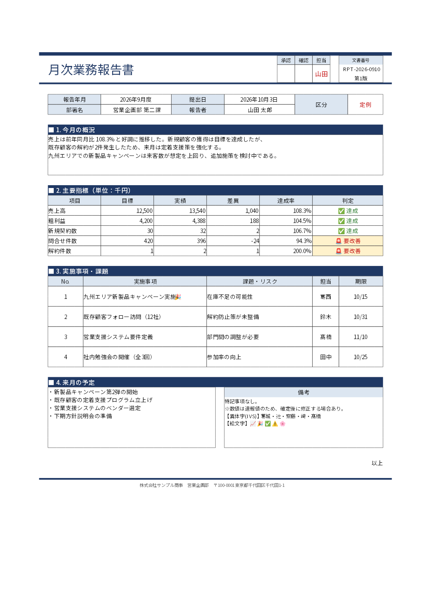

# ExcelRenderer

> PDF output keeps ordinary text searchable, but supported ideographic variation sequences (IVS) are emitted as vector outlines so the selected format 14 glyph is preserved. Those outlined IVS characters are not searchable or copyable as text.

English | [日本語](README.ja.md)

## Overview

ExcelRenderer is a .NET library for rendering Excel (`.xlsx`) worksheets as PDF or PostScript documents or page-by-page PNG and SVG images.

It separates workbook parsing, layout, drawing-command generation, and output rendering into distinct stages:

```text
Excel (.xlsx)
    -> ReportDocument
    -> RenderDocument
    -> DrawCommand
    -> PDF / PostScript / PNG / SVG
```

This makes the rendering pipeline easier to test, understand, and extend with new layout behavior or output formats.

> [!NOTE]
> ExcelRenderer is currently an MVP and does not aim for pixel-perfect parity with Microsoft Excel.

### Features

- Reads `.xlsx` workbooks with the streaming OpenXml reader
- Supports cell text, fonts, alignment, wrapping, fills, and borders
- Resolves shared cell borders once across normal and merged cells; double lines are centered on the boundary. Conflicts use a deterministic [fallback policy](docs/validation/border-resolution/README.md), pending Excel print-output measurements.
- Handles merged cells, hidden rows and columns, column widths, and row heights
- Honors print areas, page size, orientation, margins, and scaling settings
- Splits output into pages at row and column boundaries
- Renders worksheet PNG and JPEG images
- Renders header and footer text
- Produces PDF output with SkiaSharp and shared subset fonts
- Produces one PNG image per page with SkiaSharp
- Produces one self-contained SVG per page with outlined text and embedded images
- Exports AI-friendly Markdown with merged-cell HTML, layout-aware reading order, formulas, and external images
- Populates XLSX templates from C# objects or JSON with the standalone mapping package
- Recalculates a limited formula language on request; see [supported syntax and 40 functions](docs/formulas-reference.md)

## Installation

### Requirements

- .NET 10 SDK to build and test the repository
- A target framework compatible with .NET Standard 2.1 to consume the library
- Appropriate fonts installed or supplied through `FontOptions` for rendering; mapping alone does not need fonts

Choose the package for your task:

| Package | Use it for | Requirements |
| --- | --- | --- |
| `ExcelRenderer` | Render existing XLSX files to PDF, PostScript, PNG, SVG or Markdown from C# | .NET Standard 2.1-compatible application |
| `ExcelRenderer.Mapping` | Populate XLSX templates from C# objects or JSON and save XLSX | .NET Standard 2.1-compatible application; no rendering or fonts required |
| `ExcelRenderer.Fonts` | Add optional bundled Japanese and emoji fonts for rendering | Use alongside `ExcelRenderer` |
| `ExcelRenderer.Tool` | Map and convert workbooks from the command line | .NET 10 SDK |

These are the four published NuGet packages. `ExcelRenderer.OpenXml.Reader`,
`ExcelRenderer.Formulas` and `ExcelRenderer.OpenXml` are separate assemblies bundled in both `ExcelRenderer`
and `ExcelRenderer.Mapping`, not installable package IDs. For their APIs, install
either package as shown [below](#formula-and-low-level-xlsx-apis).

> [!WARNING]
> Upgrading from 1.9.0 to 1.9.1 changes public Formulas/OpenXml namespaces and breaks
> source and binary compatibility. Update imports and stored type names, and rebuild
> all dependent libraries and applications. See the [migration guide](docs/namespace-migration.md)
> for the affected types, package restore caveat and reproduced failures.

The commands below use NuGet.org and require a published version containing the
feature you need. To use a feature before its package is published, see
[Development](#development). The .NET Standard 2.1 libraries support applications
such as .NET 8 and .NET 10; .NET Framework is not supported.

The optional `ExcelRenderer.Fonts` package contains Noto Sans JP Regular TTF for
ordinary text, IPAmj Mincho for IVS rendering, and Noto Color Emoji. The `ExcelRenderer` library
does not depend on that package: install it alongside the library only when you
want those bundled resources and IVS fallback. Without it, the library uses
explicitly registered or system fonts. The CLI depends on this package and
installs it transitively. IVS rendering defaults to Gothic
(IPAmj Mincho when no bundled Gothic font supports the sequence). Set `FontOptions.IvsFontStyle` to
`IvsFontStyle.Mincho`, or pass `--ivs-font-style mincho` to the CLI, to use
IPAmj Mincho directly. See [third-party notices](THIRD-PARTY-NOTICES.md).
Set `FontOptions.ReplaceIvsWithBaseCharacter` to `true` when the library should
render an ideographic variation sequence as its base character without the
variation selector instead of selecting its IVS glyph.

### Library (NuGet)

Run this in your application's project directory (.NET Standard 2.1-compatible target required):

```bash
dotnet add package ExcelRenderer
dotnet add package ExcelRenderer.Fonts  # optional Japanese fonts
```

`ExcelRenderer` is sufficient when your application provides its own fonts.
`ExcelRenderer.Fonts` adds only the bundled font resources; it is not required
to use the library API. The package includes Noto Sans JP Regular, IPAmj Mincho,
and Noto Color Emoji under their respective licenses. See
[third-party notices](THIRD-PARTY-NOTICES.md) for redistribution requirements.

### Template mapping library (NuGet)

To generate XLSX files without rendering, add only the mapping package:

```bash
dotnet add package ExcelRenderer.Mapping
```

Use `ExcelTemplateMapper` from the `ExcelRenderer.Mapping` namespace. To render
the mapped workbook from C#, also add `ExcelRenderer` and, if needed,
`ExcelRenderer.Fonts`. Start with the [mapping guide](https://github.com/akrym1582/ExcelRenderer/blob/main/docs/mapping.md)
([Japanese](https://github.com/akrym1582/ExcelRenderer/blob/main/docs/mapping.ja.md)) for a complete template, JSON data and C# example.

### Formula and low-level XLSX APIs

For in-memory formula evaluation or low-level XLSX reading/writing without
rendering, install the published Mapping package:

```bash
dotnet add package ExcelRenderer.Mapping --version 1.9.1
```

If your application already references `ExcelRenderer` 1.9.1, it provides the same
Formulas/OpenXml APIs; no additional package is needed. When using both main and
Mapping, keep their versions aligned. Fonts are unnecessary for these APIs.

The following Reader imports require packages built from this source revision. Released 1.9.1 uses the previous OpenXml.Reading namespace. See [split migration](docs/openxml-reader-split.md).

```csharp
using ExcelRenderer.Formulas.Data;
using ExcelRenderer.Formulas.Evaluation;
using ExcelRenderer.Formulas.References;
using ExcelRenderer.Formulas.Syntax;
using ExcelRenderer.OpenXml.Reader;

var source = new InMemoryFormulaWorkbook.Builder().AddSheet("Invoice").Build();
var result = new FormulaEngine().Evaluate(
    FormulaParser.Parse("SUM(2,3)*4").Formula!,
    source, new FormulaCellAddress("Invoice", 1, 1));
// result.Success == true; result.Value.Number == 20

using var input = File.OpenRead("input.xlsx");
using var reader = OpenXmlWorkbookReader.Open(input);
var cells = reader.EnumerateCells(reader.SelectedWorksheetIndices[0]).ToArray();
```

The Formulas assembly itself uses only the BCL; the installed Mapping package
also brings its XLSX and JSON dependencies. See the [runnable package sample](samples/namespace-migration/README.md),
[formula guide](docs/formulas.md), [OpenXml guide](docs/openxml-integration.md)
and [distribution contract](docs/package-distribution.md).

### Command-line tool (dotnet tool)

Install the .NET 10 SDK, then install the CLI from NuGet.org:

```bash
dotnet tool install --global ExcelRenderer.Tool
excelrenderer --help
```

The package name is `ExcelRenderer.Tool`; the executable command is `excelrenderer`.
The tool includes the rendering, mapping and bundled font libraries. You do not
need to install their NuGet packages separately to use the CLI. These commands
assume NuGet.org is enabled in your NuGet sources.

To update an existing global installation:

```bash
dotnet tool update --global ExcelRenderer.Tool
```

For a project-local installation, run the following in the repository where you want to use the tool. Create the manifest only if one does not already exist:

```bash
dotnet new tool-manifest
dotnet tool install --local ExcelRenderer.Tool
dotnet tool run excelrenderer --help
```

Commit `.config/dotnet-tools.json` so other contributors can install the same tool version with `dotnet tool restore`.

## Quick start

Convert a workbook with the CLI:

```bash
excelrenderer pdf input.xlsx -o output.pdf
excelrenderer image input.xlsx -o ./images
excelrenderer svg input.xlsx -o ./svg-output
excelrenderer md input.xlsx -o output.md
```

Or from C#, after adding the library:

```csharp
await ExcelConverter.ConvertToPdfAsync("input.xlsx", "output.pdf");
```

Example output:



See [Command-line usage](#command-line-usage), [C# API (high-level)](#c-api-high-level), and [C# API (low-level)](#c-api-low-level) for details.

## Excel template mapping

`ExcelRenderer.Mapping` is a standalone .NET Standard 2.1 package for mapping C#
objects or JSON into XLSX templates. It supports `**` cell paths, single-row arrays,
nested `**@start-array` / `**@end-array` blocks, explicit CLR formatting and manual
page breaks. It does not depend on rendering or font packages.

For a first example, type `**Customer` into cell B2 in Excel and save the workbook
as `template.xlsx`. Create `data.json` in the same directory:

```json
{ "Customer": "Alice" }
```

Run the CLI from that directory:

```sh
excelrenderer xlsx template.xlsx --data data.json -o report.xlsx
excelrenderer pdf template.xlsx --data data.json -o report.pdf
excelrenderer render template.xlsx --data data.json --format png -o ./png-output
```

`report.xlsx` contains `Alice` in B2. The `xlsx` command saves the mapped workbook;
the other commands map it before rendering. To do the same from C#, add
`ExcelRenderer.Mapping` and use:

```csharp
using ExcelRenderer.Mapping;

ExcelTemplateMapper.Map("template.xlsx", "report.xlsx", new { Customer = "Alice" });
```

Property names are case-sensitive. Keep input and output paths different.
See [the mapping guide](https://github.com/akrym1582/ExcelRenderer/blob/main/docs/mapping.md) ([Japanese](https://github.com/akrym1582/ExcelRenderer/blob/main/docs/mapping.ja.md)) for a
complete invoice example, installation, array expansion, formatting and troubleshooting.

For the complete directive list, see the
[specification reference](https://github.com/akrym1582/ExcelRenderer/blob/main/docs/mapping.md#specification-reference).
`**@page-break` creates breaks above and left of its cell: A10 gives a row-only
break, C1 a column-only break, and C10 both. The directive cell becomes blank.
See [page breaks](https://github.com/akrym1582/ExcelRenderer/blob/main/docs/mapping.md#page-breaks)
for repeated blocks and the switch from fit-to-page to scale mode.

## Command-line usage

### Syntax and commands

After installing `ExcelRenderer.Tool`, use the following syntax. `input.xlsx` is positional and `-o` is an alias for the required `--output` option:

```text
excelrenderer <command> <input.xlsx> --output <path> [options]
```

The format-specific commands cover the common conversion cases:

```bash
excelrenderer pdf input.xlsx -o output.pdf
excelrenderer image input.xlsx -o ./images
excelrenderer svg input.xlsx -o ./svg-output
excelrenderer md input.xlsx -o output.md
```

| Command | Output | Command-specific options |
| --- | --- | --- |
| `xlsx` | One mapped XLSX file | `--data <data.json>` (required) |
| `pdf` | One PDF file | `--sheet <name>` |
| `image` | One paginated PNG per worksheet page | `--sheet <name>`, `--dpi <number>` (default: `144`) |
| `svg` | One self-contained SVG per worksheet page | `--sheet <name>` |
| `ps` | One multipage PostScript file with embedded TrueType fonts | `--sheet <name>` and buffer options |
| `markdown` / `md` | One Markdown file and optional extracted images | `--sheet`, `--image-dir`, `--[no-]images`, `--[no-]cell-addresses`, `--[no-]formulas`, `--[no-]layout-detection`, `--[no-]region-detection` |
| `render` | PDF/PostScript file, or a PNG/SVG/Markdown output directory | `--format pdf\|ps\|png\|svg\|markdown` plus selection, layout, diagnostics, manifest, and font-policy options |

All rendering commands also accept `--data <data.json>` to populate a template
before conversion. Without it, they convert the existing workbook as before.
See [Excel template mapping](#excel-template-mapping) for examples.

### Font options

Every rendering command accepts these font-source options; `xlsx` does not need fonts:

| Option | Meaning |
| --- | --- |
| `--font-dir <directory>` | Recursively search an additional directory. Repeat the option, or provide multiple values, to add directories. |
| `--font-file <file>` | Register a font file directly. Repeat the option, or provide multiple values; order is significant. Supported font content includes TrueType/OpenType `.ttf`, `.tte`, and `.otf` files. |
| `--fallback-font <family>` | Replace the default fallback-family list with the supplied families, in command-line order. Repeat it to specify a fallback chain. |
| `--no-system-fonts` | Do not search operating-system font directories. Explicit files, added directories, and bundled CLI fonts remain available. |
| `--font-policy bundled\|requested` | Choose whether bundled compatibility fonts (the default) or requested/explicit fonts take priority. |
| `--ivs-font-style gothic\|mincho` | Choose the bundled font style used for ideographic variation sequences (default: `gothic`). |

Font options affect glyph selection for PDF, PNG, and SVG. Markdown does not render glyphs, but accepts the same options so scripts can switch commands without changing their shared font arguments. Paths containing spaces must be quoted. For reproducible rendering in a container, for example:

```bash
excelrenderer pdf report.xlsx -o report.pdf \
  --font-dir /app/fonts \
  --font-file /app/company-fonts/ReportSans.ttf \
  --fallback-font "Noto Sans JP" \
  --fallback-font "Liberation Sans" \
  --no-system-fonts
```

Run `excelrenderer --help` to list commands and `excelrenderer <command> --help` for the complete, current option list.

### Continuous image layout

The unified `render` command can generate a single continuous image per selected worksheet without print-page margins, breaks, titles, or headers:

```bash
excelrenderer render input.xlsx -o ./continuous-images --format svg --image-layout continuous
```

Continuous layout is available only for PNG and SVG, cannot be combined with `--pages`, and uses the sheet's used range rather than its print area unless an explicit range is supplied. PNG continuous output defaults to a 100 million-pixel limit (about 381 MiB for an RGBA bitmap before encoder overhead); set `RenderRequest.MaxPngPixels` only to a safe finite value when larger canvases are required.

### Explicit ranges, trimming and cell hyperlinks

Use `render` for range selection and content trimming:

```bash
excelrenderer render input.xlsx -o report.pdf --format pdf \
  --sheet "売上 2026" --range "'売上 2026'!B2:F40" \
  --trim --trim-padding 2 --hyperlinks preserve --manifest report.json
excelrenderer render input.xlsx -o images --format png \
  --sheet Sheet1 --range B2:F40 --image-layout continuous --trim
excelrenderer render input.xlsx -o svg --format svg --sheet Sheet1 --range B2:F40 --trim
excelrenderer render input.xlsx -o markdown --format markdown --hyperlinks preserve
```

| Option | Behavior |
|---|---|
| `--range` | Repeat once per selected sheet. Accepts a single A1 cell or forward rectangle, `$` and lowercase letters. Quote sheet names with spaces; escape an apostrophe as `''`. Unqualified ranges require exactly one selected sheet. |
| `--max-range-cells` | Positive total limit for explicitly selected rectangles, default 1,000,000. Includes empty cells; this is a processing limit, not a memory guarantee. |
| `--trim` | Crop each already paginated page or continuous canvas around visible drawing bounds without reflowing or rescaling content. |
| `--trim-padding` | Nonnegative finite padding in points, default 2; requires `--trim`. |
| `--hyperlinks preserve\|none` | Default `preserve`; also available on `pdf` and `markdown`/`md`. `none` retains display text and formatting without hyperlink diagnostics, anchors or link lists. |

A range replaces that sheet's print areas, preserves paper, margins, scaling and page order, and intersects repeated print titles with the selection. Ranges never select additional sheets. Entire rows/columns, unions, names, reversed ranges and external/3D references are rejected. A continuous image uses the explicit rectangle without expansion by outside objects. Partially selected merges retain their original measurement, alignment and borders and are clipped, with a `ClippedMergedCell` warning. `--pages` selects document page numbers after range pagination and before trimming. Hidden-only selections keep an empty page/canvas.

Trimming includes visible fills (including explicitly white fills), strokes, positioned text, images, shapes and headers/footers. Font glyph bounds are used where available; emoji and compatibility glyphs use conservative finalized logical bounds. This is drawing-bound cropping, not pixel-based removal of white or transparent areas inside images. An empty trimmed page remains 1×1pt plus padding (5×5pt by default), with `EmptyContent` information. PNG dimensions use ceiling at the requested DPI, and `RenderRequest.MaxPngPixels` applies to both page and continuous output before bitmap allocation.

PDF and Markdown preserve `http`, `https`, `mailto` and same-workbook cell links, including range references, empty source cells, simple scoped A1 names, and literal-string `HYPERLINK` formulas. Explicit XML definitions take precedence over formulas. Only saved displays are used; uncached formulas display empty text and report `FormulaCachedValueMissing`. PDF annotations are attached to the final merged document and follow page selection and trimming. Markdown uses stable `xl-sN-rN-cN` anchors and explicit target/source lists where a blank cell or source range cannot carry a natural label. PNG and SVG retain cell appearance without clickable links or hyperlink warnings. SVG links and link sidecars are not generated.

Unsafe URIs (including local files, relative paths, UNC, embedded HTTP credentials, control characters and unsupported schemes), conflicting definitions and unsupported dynamic formulas retain display text and yield `HyperlinkRejected`/`HyperlinkUnsupported` warnings. Missing or omitted internal destinations yield `HyperlinkTargetOmitted`; excluded sources do not produce destination warnings. Diagnostics omit URI/recipient/query contents. Readable invalid link definitions are warnings; corrupt packages and missing hyperlink relationships are fatal input errors. Strict mode or matching `--warnings-as-errors` stops output before the sink opens. The PDF CLI creates/truncates its file only after preflight; identical input/output paths are rejected before reading.

The stream API exposes the same options without changing existing positional constructors:

```csharp
var request = new RenderRequest
{
    OutputFormat = OutputFormat.Pdf,
    Selection = new SelectionOptions
    {
        SheetNames = new[] { "Sheet1" },
        Ranges = new[] { new SheetRangeSelection("Sheet1", new CellRange(new(2, 2), new(40, 6))) },
        MaxRangeCells = 1_000_000,
    },
    Trim = new TrimOptions { Enabled = true, PaddingPoints = 2 },
    Hyperlinks = HyperlinkMode.Preserve,
};
```

Import `ExcelRenderer.Rendering` and `ExcelRenderer.Model` for these settings. PDF/Markdown legacy options also expose `Hyperlinks`. Markdown rejects ranges, trimming and page selection before output. With no ranges or trim, page dimensions and existing layout stay unchanged. Schema-version-1 manifests add optional page/range/crop metadata: widths/heights describe final output, while original dimensions and crop coordinates describe the page before trim. Missing range means existing print/used-range selection; missing crop/padding means identity translation. No link targets or full tooltips are listed in manifests.

## C# API (high-level)

After installing `ExcelRenderer`, the facade API performs the complete read, layout, render, and write pipeline:

```csharp
using ExcelRenderer;

await ExcelConverter.ConvertToPdfAsync("input.xlsx", "output.pdf");
await ExcelConverter.ConvertToImagesAsync("input.xlsx", "./images");
await ExcelConverter.ConvertToSvgAsync("input.xlsx", "./svg-output");
await ExcelConverter.ConvertToPostScriptAsync("input.xlsx", "report.ps");
await ExcelConverter.ConvertToMarkdownAsync("input.xlsx", "output.md");
```

For stream-based integrations, `RenderAsync` reads from the input's current position and leaves both
the input stream and a `SingleStreamOutputSink` output stream open. Use `DirectoryOutputSink` for
page-by-page PNG/SVG output. `RenderRequest` selects sheets by exact name (in request order) and
can select rendered PDF/PostScript/PNG/SVG document pages; Markdown does not support page selection.
`ConversionManifest.WriteAsync` writes the completed artifact metadata and diagnostics as schema
version 1 JSON with relative artifact names.

PDF export requires a successful complete pixel decode; corrupt or incomplete images are skipped with
`ImageDecodeFailed` warnings. Diagnostics include the sheet, source page, image bounds,
byte length, up to 16 header bytes, and the decode failure reason. The `render` command
prints warnings to stderr; use `--manifest report.json` to save these details as JSON.
Strict mode or treating `ImageDecodeFailed` as an error stops conversion instead.
Low-level `PdfRenderer` callers can receive warnings through `DiagnosticHandler`;
warnings are also written to `System.Diagnostics.Trace` listeners.

Use `PdfExportOptions`, `ImageExportOptions`, `SvgExportOptions`, `PostScriptExportOptions`, and `MarkdownExportOptions` to select a worksheet or configure format-specific behavior. Existing output files, and non-empty image or SVG output directories, are not overwritten.

## Column widths, saved row heights, and pagination

Saved row heights (`ht`, in points) are honored even when `customHeight` is false or
omitted. Missing heights use the sheet default, then 15pt. Hidden rows remain hidden;
text measurement never increases saved row heights. Only saved breaks with `man=true`
or `man=1` force a page break. Fit-to-pages continues to ignore manual breaks.

`ExcelReadOptions.ColumnWidthMetrics` now defaults to `SourceFont`. Column widths use
the workbook Normal style's original digit width, independently of drawing fallback
fonts. Source resolution uses only the font manager's permitted registrations and search
roots (`AllowSystemFonts` is respected), including verified localized family aliases.
You can measure with an original font while drawing with Noto:

```csharp
using ExcelRenderer;
using ExcelRenderer.Excel;

var read = new ExcelReadOptions
{
    ColumnWidthMetrics = new ColumnWidthMetricsOptions
    {
        SourceFontFile = "fonts/original-normal.ttc",
        SourceFontCollectionIndex = 0,
    },
};
await ExcelConverter.ConvertToPdfAsync("input.xlsx", "output.pdf",
    new PdfExportOptions { ReadOptions = read });
```

Alternatively set `MaximumDigitWidthPixels96Dpi` to the measured maximum advance of
`0`–`9` for that workbook's Normal font, size, weight, and italic style at 96 DPI.
This explicit value takes precedence and applies to **all sheets** in the workbook.
It must be finite and at least 1; collection indices must be nonnegative and require
a source file. Missing/invalid explicit files and invalid face indices are errors.
A layout font is never registered as a drawing font, and requires no Fonts package.

```bash
excelrenderer pdf input.xlsx -o output.pdf --layout-font original-normal.ttc --layout-font-index 0
# 9 is an illustrative measured value, not a preset for Meiryo or any other family.
excelrenderer render input.xlsx --format pdf -o output.pdf --column-width-mdw 9
# Reproduce historical rendering-font column metrics during migration:
excelrenderer pdf input.xlsx -o output.pdf --column-width-metrics legacy
```

The shared flags are `--column-width-mdw`, `--layout-font`, `--layout-font-index`, and
`--column-width-metrics source|legacy`. In the library, migration compatibility is
`ColumnWidthMetrics = new() { Mode = ColumnWidthMetricsMode.RenderingFontLegacy }`.
Legacy cannot be combined with a source file; explicit MDW still takes precedence.
All rendering formats, range/continuous rendering, and page-selection preflight use
the same read settings and conversion-local metric decisions. Core's independent
single-supplied-font contract is unchanged.

If the original family is unavailable, SourceFont uses the deterministic 7px
compatibility metric and reports `MaximumDigitWidthFallback`. StrictMode treats this
warning as a conversion failure. This does **not**
guarantee Excel-equivalent geometry. Supply the original font or its measured MDW
for accurate column sizing. `MaximumDigitWidthResolved` identifies the requested
Normal style, physical measurement source, MDW, and decision (`override`, `source-file`,
`exact-font`, or `legacy`). `SavedPageBreaks` reports adopted/manual and excluded/automatic
break counts. `DiagnosticOptions.EnableLayoutWarnings` also enables per-print-area
`PaginationMetrics` (dimensions, margins, scale, and horizontal/vertical page counts).
See [validation evidence](docs/pagination-source-metrics-validation.md) for synthetic
fixtures and the limits of comparisons without the user's workbook or Windows fonts.

### Direct PDF HTTP responses

PDF `RenderAsync` supports writable nonseekable streams that prohibit synchronous I/O,
including ASP.NET Core `Response.Body`. `AllowSynchronousIO = true` is unnecessary:

```csharp
using ExcelRenderer;
using ExcelRenderer.Rendering;

// xlsx is a readable stream prepared by the application.
httpContext.Response.ContentType = "application/pdf";
httpContext.Response.Headers["Content-Disposition"] = "attachment; filename=report.pdf";
await ExcelConverter.RenderAsync(
    xlsx,
    new RenderRequest { OutputFormat = OutputFormat.Pdf },
    new SingleStreamOutputSink(httpContext.Response.Body),
    httpContext.RequestAborted);
```

Configure `RenderRequest.FontOptions` for your deployment. The
[compilable HTTP sample](samples/ExcelRenderer.Http.Sample) supplies an explicit font
and includes main-library and Core endpoints, both tested against real Kestrel with
synchronous I/O disabled. Do not dispose `Response.Body` or return an additional File/JSON
result after writing it. Content-Length need not be known in advance; let the server
handle HTTP framing.

The converter generates all pages into its existing seekable spool (bounded memory,
then a temporary file) and parses the structure before final transmission. It adds no
complete final-PDF memory buffer. Syntax uses a 64 KiB aggregation buffer and payloads
an 80 KiB transfer buffer. Each write is awaited before the next; this is not immediate
first-page delivery. Workbook reading, layout and Skia drawing still execute synchronously;
async applies to final output I/O. Fonts, images, layout and native drawing require their
own memory. The sink path awaits one final `FlushAsync` before completing the artifact.

Cancellation or failure may leave partial output. After transmission begins, already
sent bytes cannot be withdrawn or replaced by a normal JSON error; let the host handle
the exception or abort the connection. `SingleStreamOutputSink` leaves the destination
open. Failed artifacts receive `AbortAsync` with a noncancelable cleanup token; cleanup
errors are retained in the original exception's `Data["AbortException"]`.

Core `ConvertAsync(xlsx, response.Body, options, requestAborted)` has the same async-only,
nonseekable output support, requires an explicit regular font, and leaves final flushing
to the caller. See [Core stream contracts](docs/core.md#streams-and-lifetime).
This guarantee applies to PDF; other output formats retain their existing behavior.

## C# API (low-level)

Install the `ExcelRenderer` package or reference the project, then run the workbook through the layout and rendering pipeline:

```csharp
using ExcelRenderer.Drawing;
using ExcelRenderer.Excel;
using ExcelRenderer.Layout;
using ExcelRenderer.Pdf;
using ExcelRenderer.SkiaSharp;

var document = new ExcelReader().Read("report.xlsx");
var sheet = document.Sheets[0];

var layoutEngine = new ReportLayoutEngine(new SkiaTextMeasurer());
var renderDocument = layoutEngine.Layout(sheet);
var commands = new DrawCommandGeneratorPass().Generate(renderDocument);

using var output = File.Create("report.pdf");
new PdfRenderer().Render(commands, sheet.PageSettings, output);
```

`ExcelReader` preserves whether an xlsx uses an explicit percentage or Fit-to-pages in
`PageSettings.ScaleMode`. Fit-to-pages never enlarges content beyond 100%. When constructing
`PageSettings` directly, leaving `ScaleMode` unset preserves the legacy rule that a positive
`Scale` wins; opt in explicitly when a fit count must override the positional default scale:

```csharp
var settings = new PageSettings(FitToPagesWide: 1)
{
    ScaleMode = PrintScaleMode.FitToPages,
};
```

For xlsx input, explicit and default raw column widths are converted at the fixed Excel
reference DPI of 96; output PNG DPI does not change sheet geometry. The Normal style is resolved
through its style XF and theme major/minor font before measuring digits 0–9 with the configured
font manager. If that font cannot be measured, a 7px compatibility width is used and
`MaximumDigitWidthFallback` is reported through conversion diagnostics.

Distinct print areas are paginated independently without filling their bounding rectangle.
Explicit-scale output honors saved row and column page breaks and the worksheet page order;
Fit-to-pages ignores manual breaks. The combined pages are renumbered once across all areas, so
page fields and PDF/PNG/SVG page selection use the same sequence. Objects intersecting more than
one page are placed from the same source geometry on each page and clipped to that page's body
viewport rather than merely to the physical paper. Saved horizontal and vertical centering moves
cells, objects, and their body clip together; continuous output intentionally ignores print setup.
Cell indentation, content padding, ordinary rotation, and stacked top-to-bottom text are carried
into PDF, PNG, and SVG drawing.

Wrapped cell text is finalized during layout into lines and resolved font runs, including
grapheme-safe forced breaks and explicit-newline markers. The result is carried by the draw
command. PDF, PNG, and SVG consume the finalized effective font size, per-line baseline and
height, selected run font, and logical run X/advance instead of independently wrapping,
shrinking, or advancing the text. Commands created directly without a `TextLayout` retain the
legacy renderer-side compatibility path.
On that compatibility path, PNG and SVG select one Skia system face from the requested family,
weight, and slant and retain that same face for measurement, wrapping, shrinking, and drawing.

`TextLayoutResult.EffectiveFontSize` preserves a compatibility distinction: results created with
the original two-argument constructor use the command style size, while an explicitly assigned zero
suppresses drawing. PDF and Skia reuse the physical face selected for each finalized run, including
memory-backed faces. Finalized underlines are drawn once from the stored line origin, baseline, and
width; PDF font decoration is disabled on that path so it cannot produce a second underline.

DrawingML picture metadata preserves and resolves one-cell, two-cell, and absolute anchors in points together
with marker offsets, extents, `editAs`, source crop, rotation, flips, and worksheet drawing order.
Source crop is applied by both renderer backends without changing the destination bounds.

To render the same commands as page-by-page PNG files:

```csharp
using ExcelRenderer.SkiaSharp;

new PngRenderer().Render(
    commands,
    sheet.PageSettings,
    pageNumber => File.Create($"report-{pageNumber}.png"),
    dpi: 144);
```

To render one self-contained SVG file per page, with dimensions and coordinates in PDF points:

```csharp
new SvgRenderer().Render(
    commands,
    sheet.PageSettings,
    pageNumber => File.Create($"report-{pageNumber}.svg"));
```

SVG text is converted to vector paths so the viewer does not need the source font. This intentionally prevents text search and copy; it does not prevent editing. Raster images are embedded in each SVG. Text shaping has the same limitations as PNG rendering, and complex scripts or color/bitmap-only glyphs are not guaranteed.

To convert an entire workbook to Markdown and extract its images:

```csharp
using ExcelRenderer.Markdown;

await ExcelMarkdownConverter.ConvertAsync("sample.xlsx", "output");
```

This creates `output/sample.md` and image files under `output/images`. Use
`MarkdownExportOptions` to control formula/address metadata, hidden rows and columns,
nearby image text, layout analysis, and image export. Markdown export consumes the
same `ReportDocument` model as the renderers and does not alter the PDF/PNG pipeline.

## PostScript output

```bash
excelrenderer ps input.xlsx -o report.ps --no-system-fonts
excelrenderer render input.xlsx -o report.ps --format ps --pages 1,3 --manifest report.json
```

`OutputFormat.PostScript` writes one `application/postscript` artifact (`workbook.ps`
with `DirectoryOutputSink`). `SingleStreamOutputSink` accepts nonseekable streams and
leaves them open. `ConvertToPostScriptAsync` refuses existing output files; `render`
uses the existing file replacement policy. Sheets, ranges, pages, trimming, formulas,
rich text and font fallback use the shared layout. Continuous image layout is rejected.
Hyperlinks retain their visible appearance without clickable annotations.

The renderer generates PostScript directly in C#. Text uses embedded static **glyf
TrueType / Type 42** subsets and `show`, with multiple 256-code encoding banks when
needed; TTC faces use the configured collection index. Requires LanguageLevel 3,
Type 42 and PostScript 3011+ large sfnt table support. CFF/CFF2, variable/color fonts,
restricted embedding and prohibited subsetting fail with `PostScriptFontUnsupported`.
Partial alpha fails with `PostScriptTransparencyUnsupported`; mixed transparent/opaque
image masks fail with `PostScriptImageTransparencyUnsupported`. Fully invisible
objects may be omitted. Invalid images fail with `PostScriptImageDecodeFailed`.
There is no page raster fallback or silent alpha compositing.

Original Unicode (including IVS and supplementary characters), run positions and
code/GID mappings are preserved as versioned nonexecuting comments. This is distinct
from a viewer's search/copy support. Ghostscript tests verify standard Latin, kana
and kanji extraction; **arbitrary IVS/supplementary extraction and retention through
PDF conversion are not guaranteed**. See [format, decoder and validation details](docs/postscript.md).

`RenderRequest.Buffering` / `PostScriptExportOptions.Buffering` bound the document
spool with the same temporary-file policy as SVG/PDF. Fonts are shared per document;
pages are processed individually. These settings do not cap the font or image decode
working set. Ghostscript is an independent development/CI validator, has no role in
the library/CLI runtime and is not bundled in NuGet, the tool or ZIP distributions.
The project retains its MIT license; Ghostscript has its own AGPL/commercial license.

## Partial cell formatting and optional diagnostics

PDF, PNG and SVG preserve partial font family, size, bold, italic, color and single
underline in ordinary string cells. `ReportCell.RichTextRuns` contains effective
`CellTextRun` values; `Text` remains the complete plain string. Manual models must
supply matching text and valid positive sizes. The built-in measurer implements
`IRichTextLayoutService`; existing custom measurers keep working with a cell-font
fallback. Core-only output keeps its single regular font. Markdown stays plain text.

Partial formatting with rotated/vertical cell text falls back to the cell font.
Strikethrough, superscript/subscript, double/accounting underlines and phonetics are
not rendered. Enable additional detection to report unsupported partial formatting
and unsupported conditional formatting. Anchored chart diagnostics retain the existing
`UnsupportedDrawingObject` code and are filtered during selected-page preflight
when additional detection is enabled. Charts are not rendered. Supported conditional formatting is applied by default in the main library.

```sh
excelrenderer render input.xlsx -o output.pdf --format pdf \
  --layout-warnings --min-readable-font-size 6 --detect-unsupported-features
```

`DiagnosticOptions.EnableLayoutWarnings` defaults to `false`.
`MinimumReadableFontSize` defaults to 6pt and must be finite and positive; setting
it alone does not enable warnings. The CLI requires `--layout-warnings` with
`--min-readable-font-size`. `CellTextClipped` checks finalized logical line placement
for horizontal wrapped/shrunk cells with a 0.25pt tolerance, not complete glyph ink
bounds. `CellTextTooSmall` uses final scaled visible run sizes. These warnings do
not resize cells and are not emitted for Markdown. New warnings run in preflight;
diagnostic failure occurs before opening output sinks.

With `DetectUnsupportedFeatures`, chart sheets are reported at sheet level with unknown
cell position using `UnsupportedDrawingObject`; they add no blank output page. Selecting
only chart sheets returns diagnostics and no artifacts. `RenderRequest.TextMeasurer`
can supply a caller-owned legacy service. Without `IRichTextLayoutService`, rich cells
use the cell font and emit opt-in `RichTextLayoutFallback` in preflight. The built-in
service remains the default. No additional glyph measurement is done just for diagnostics.

## Conditional formatting

The main library applies supported `cellIs`, expression, text, blank and error rules
by default, plus duplicate/unique values, top/bottom N or N%, mean/population-standard-
deviation comparisons and two/three-color scales. Supported styles include solid fills,
font color/bold/italic/single underline and four border edges. Rules share priority, `stopIfTrue`, typed values and rich-text handling
across PDF, PNG and SVG. Disable with
`new ExcelReadOptions { ApplyConditionalFormatting = false }`, also available through
`RenderRequest.ReadOptions`. Cached mode uses saved dependency values; Recalculate
shares the display calculation session. **Core retains ordinary saved styles and does
not evaluate conditional formatting.** Markdown adds no color syntax.

Population rules include hidden and selected-out source values. Unsupported rules/styles
and evaluation failures remain diagnosable. Collapsed color-scale thresholds retain
ordinary fill with a diagnostic. Data bars, icon sets, timePeriod, conditional number
formats and x14 rendering remain unsupported; desktop Excel equivalence is unverified.
See [conditional formatting support, diagnostics and verification](docs/conditional-formatting.md).
The [Phase 2 validation report](docs/validation/conditional-formatting-phase2/README.md)
records functional checks and performance measurements; the 5% regression goal remains
unconfirmed for the small input without conditional formatting.

## Workbook reading and formula results

Reader and Mapping always use OpenXml. See
[workbook APIs, CLI usage, supported scope and stream guarantees](docs/openxml-integration.md).
Existing callers can follow the [engine-selection migration](docs/engine-selection-removal.md).
`ExcelRenderer.OpenXml.Reader` provides reading and input handling; `ExcelRenderer.OpenXml` provides writing and recalculation;
ClosedXML has been removed from the libraries, CLI, tests and tools. The Reader style
API has changed to `ExcelStyleConverter.Convert(CellStyleInfo, CellValueType)`; see
[breaking changes and migration](docs/closedxml-removal-compatibility.md). Low-level APIs are documented in the
[OpenXml reader reference](docs/openxml-reader.md).

Core always displays saved formula values. Formula display defaults to `FormulaDisplayMode.CachedValue` in the main
Reader, export APIs and CLI (`--formula-mode cached`). Saved results may be stale;
missing caches produce `FormulaCachedValueMissing`. Opt in to the limited built-in
calculator with `FormulaDisplayMode.Recalculate` or `--formula-mode recalculate`.
The independent BCL-only engine supports 40 functions and strict diagnostics;
unsupported reached formulas never fall back to saved results. `Legacy` remains
unsupported. The [formula support reference](docs/formulas-reference.md) lists every
function with argument counts and examples, supported syntax, errors and limits.
See [formula calculation](docs/formulas.md) for API examples, selected
source scope, cache invalidation, compatibility limits and validation.

Default Mapping rejects value
formulas; explicit `MappingOptions.FormulaCalculationMode = Recalculate` enables
supported formulas with AST-based row-reference rewriting and recalculation.
Mapped strings beginning with `=` remain strings. See the [Mapping guide](docs/mapping.md).

## Fonts

When loading the optional bundled fonts, ExcelRenderer looks for each expected
file name (`NotoSansJP-Regular.ttf`, `ipamjm.ttf`, and `NotoColorEmoji.ttf`) in
this order:

1. Embedded resources in `*.dll` files directly beside `ExcelRenderer.dll`.
   A resource name must equal the font file name or end with `.` plus that
   name. DLLs are checked in ordinal path order; DLLs that cannot be loaded or
   inspected are skipped.
2. Loose files with the exact font file name anywhere in the directory
   containing `ExcelRenderer.dll` or its subdirectories. If several match, the
   first path in ordinal order is used.

An embedded resource takes precedence over a loose file. The DLL search is not
recursive; only the loose-file search includes subdirectories.

```csharp
using ExcelRenderer;
using ExcelRenderer.Fonts;

await ExcelConverter.ConvertToPdfAsync("report.xlsx", "report.pdf",
    new PdfExportOptions
    {
        FontOptions = new FontOptions
        {
            FontFiles = ["/app/fonts/NotoSansJP-Regular.ttf"],
            AllowSystemFonts = false,
            UseFontPack = false,
        },
    });
```

All commands accept the font options described above. `--font-file` reads each
font directly and registers its internal family and style; supported TrueType/OpenType content can
therefore be supplied as `.ttf`, Windows EUDC `.tte`, or `.otf` without relying on its extension.
For example: `--font-file /app/fonts/report.ttf --font-file C:\Windows\Fonts\EUDC.TTE`.
For BMP private-use characters (U+E000–U+F8FF), the requested font is tried first, followed by
these files in command-line order and then normal family fallbacks. If none contains the glyph,
`MissingPrivateUseGlyph` is reported and U+FFFD is rendered; `--strict` and
`--warnings-as-errors MissingPrivateUseGlyph` can make this a conversion failure. Font files must
be readable and valid, and users are responsible for their licenses and PDF embedding rights.
The option has no effect on Markdown output because Markdown does not render glyphs.
`bundled` is the default for compatibility;
`requested` prioritizes registered and supplied font directories before configured fallbacks and the
bundled font. Font fallback is selected per Unicode text element, so surrogate pairs and combining
sequences are not split.

## Architecture

Resolved PDF fonts use immutable snapshots. A conversion owns its font resources; finalized public layouts retain the snapshots they need. Global resolver registrations use weak references and are cleaned after each conversion.

For the PDF-only source project (no separate NuGet package), see [ExcelRenderer Core](docs/core.md).

The main package includes `ExcelRenderer.Core.dll` from the same build; Core is also available as a source ProjectReference. Basic reading, geometry/page layout, drawing and PDF operations are shared; advanced features remain in the main library. See [the shared Core architecture](docs/core-architecture.md) and [verification results](docs/core-refactor-validation.md).

ExcelRenderer converts a workbook to `ReportDocument`, `RenderDocument`, and `DrawCommand`, then renders PDF, PNG, or SVG.

```text
Excel (.xlsx) -> ReportDocument -> RenderDocument -> DrawCommand -> PDF / PostScript / PNG / SVG
```

See [Architecture](docs/architecture.md) for the layout passes, drawing commands, renderers, extension points, and source layout.

## Current limitations

- Charts are not supported.
- Formula display uses saved results by default; explicit recalculation supports the
  [documented syntax and 40 functions](docs/formulas-reference.md). Full Excel calculation compatibility is not guaranteed.
- Conditional formatting supports Phase 1 and Phase 2 rules in the main library; Core uses ordinary saved styles. See [support and limitations](docs/conditional-formatting.md).
- Not every paper size or header/footer formatting code is supported.
- Page breaks occur only at row and column boundaries.
- Japanese top-to-bottom mode stacks Unicode text elements; it does not yet select full
  typographic vertical glyph variants or reproduce every Japanese line-breaking rule.
- Drawing anchors are resolved on print-area-independent sheet geometry. XML row/column overrides
  outside the used and print ranges are retained, and hidden rows/columns occupy 0 pt. The latter
  anchor behavior has not been verified against desktop Excel. Repeated titles do not repeat drawing objects.
- Output can differ from Excel because font measurement and rendering engines differ.

Command finalization, two-pass PDF/PS collection, bounded CF/alpha/ink caches and the current measurements are documented in [render finalization and performance](docs/render-finalization-performance.md).

## PDF performance

The stream converter draws all pages directly into one PDF document and saves once.
Native font faces, line metrics and PDF fonts are reused within each conversion;
native faces are disposed on success, cancellation and failure. Unused Skia font strikes
are purged at conversion end to release retained native font data. Text caches are bounded.
Sparse sheet coordinates, page candidates and merged-cell queries use indices, and equal
converted styles share immutable values. Styled blank cells remain part of the model.

The converter plans page bands first, selects pages in document order, and preflights
all selected output dimensions, trimming and links before opening any output sink.
It then generates and writes one page at a time. Paginated output uses two page
passes; public `ReportLayoutEngine.Layout` remains a materializing compatibility API.
Continuous PNG/SVG rescans cells by drawing layer, preserving backgrounds, borders,
text and object order without keeping all commands. Markdown retains its existing path.
Border resolution retains and sorts edge metadata, using memory proportional to the
number of defined edges. An unselected continuous canvas includes stroke extents;
an explicit range keeps its original clip.

Selected-sheet body models and drawing-range projection reduce retained models.
OS and additional-directory font scans retain metadata; a physical face's bytes and
SHA256 identity are loaded once when first selected. Explicit font files and registrations
are validated and snapshotted immediately. Optional font-pack data is also loaded on demand.
An OS font is not a complete snapshot until its first selection; a file that changes or
disappears before that read raises a font load error. Physical measurement/drawing fonts
are immutable conversion-owned snapshots; there is no global font resolver or conversion lock.

Skia retains its final document and resources until native close and the structural save.
The OpenXml Reader retains source styles and shared strings. Layout geometry and selected models also
scale with workbook size. This is not constant-memory streaming.
See the [phase 3 measurements](docs/phase3-performance.ja.md) and the historical
[PDF](docs/pdf-performance.ja.md) and [image](docs/image-performance.ja.md) reports.

## PNG and SVG performance and buffering

PNG encoding uses the existing bitmap pixels. Page output keeps one bitmap at a time;
continuous PNG remains one worksheet per PNG with one full bitmap, not scanline or tiled
encoding. Its RGBA pixels require approximately `4 × width × height` bytes plus alignment
and encoder overhead. Both PNG APIs validate dimensions and enforce their pixel limit.
A conversion-local image cache estimates decoded resource memory and uses a 64 MiB LRU
budget; an image exceeding that budget is owned only during its active draw. Skia's
retained document image resources are additional to that estimate.

SVG keeps Skia's SVG canvas and streaming XML normalization (outlined text, embedded
images, point dimensions, and `viewBox`). Its seekable intermediate buffer spills before
exceeding the configured memory capacity. Skia may also buffer native SVG data, so the
stream threshold does not bound the whole conversion's memory.

`RenderRequest.Buffering`, `SvgExportOptions.Buffering`, and overloads of
`SvgRenderer.Render`, `RenderPage`, and `RenderCanvas` accept `RenderBufferOptions`:

`RenderRequest.Buffering` also controls Skia PDF's intermediate spool.

| Property | Default | Meaning |
|---|---|---|
| `MemoryThresholdBytes` | 8,388,608 | Maximum intermediate memory capacity in bytes. |
| `AllowTemporaryFiles` | `true` | Spill once to a temporary file above the threshold; when false, reject excess data. |
| `TemporaryDirectory` | `null` | System temp directory, or the specified existing directory. |

The `render` and `svg` CLI commands expose `--buffer-memory-threshold` (bytes),
`--no-buffer-temp`, and `--buffer-temp-directory`:

```bash
excelrenderer render input.xlsx -o ./svg --format svg --buffer-memory-threshold 8388608
excelrenderer svg input.xlsx -o ./svg --buffer-memory-threshold 1048576 --buffer-temp-directory ./existing-temp
```

These options control the SVG, Skia PDF and PostScript intermediate spools; they do not bound PNG bitmap allocations.
They are independent of `WorkbookInputOptions`: input buffering now spools to a seekable
temporary file when its own threshold is exceeded and temporary files are allowed.
Readers use independent cursors without converting the spool back to a byte array.
Temporary buffers are cleaned up on success, cancellation, and failures; caller-owned
input and output streams stay open. Heavy native drawing and encoding operations cannot be interrupted immediately.

## Development

The Formulas/OpenXml API namespaces now follow their source folders. See the
[namespace migration guide](docs/namespace-migration.md) for updated imports and public type locations.


NuGet publication is limited to `ExcelRenderer`, `ExcelRenderer.Mapping`,
`ExcelRenderer.Tool` and `ExcelRenderer.Fonts`. Core, OpenXml.Reader, OpenXml and Formulas are
source projects whose assemblies ship inside those packages; they are not published
separately. See [package distribution](docs/package-distribution.md).


To try the CLI from source before publishing, create and install a local package:

```bash
dotnet pack src/ExcelRenderer/ExcelRenderer.csproj -c Release -o artifacts/packages
dotnet pack src/ExcelRenderer.Mapping/ExcelRenderer.Mapping.csproj -c Release -o artifacts/packages
dotnet pack src/ExcelRenderer.Fonts/ExcelRenderer.Fonts.csproj -c Release -o artifacts/packages
dotnet pack src/ExcelRenderer.Tool/ExcelRenderer.Tool.csproj -c Release -o artifacts/packages
dotnet tool install --tool-path ./artifacts/tool-test --add-source ./artifacts/packages ExcelRenderer.Tool
./artifacts/tool-test/excelrenderer --help
```

Run the test suite from the repository root:

```bash
dotnet test ExcelRenderer.slnx
```

Projects are under `src/`, and their corresponding test projects are under `tests/`.
To try the mapping library from a local package, register the built package directory
alongside NuGet.org, then add the package in your application project:

```bash
dotnet nuget add source <absolute-path-to-artifacts/packages> --name ExcelRendererLocal
dotnet add package ExcelRenderer.Mapping
```

Replace the placeholder with the actual directory path. Skip source registration
if it is already configured. Keep NuGet.org enabled for dependencies such as DocumentFormat.OpenXml.

## Documentation

| Topic | Guide |
| --- | --- |
| Workbook reading/mapping, formula results, CLI and stream contracts | [OpenXml integration](docs/openxml-integration.md) ([日本語](docs/openxml-integration.ja.md)) |
| Formula syntax, supported functions, coercion, errors and limits | [Formula support reference](docs/formulas-reference.md) ([日本語](docs/formulas-reference.ja.md)) |
| Explicit recalculation, typed caches and saving APIs | [Formula calculation](docs/formulas.md) ([日本語](docs/formulas.ja.md)) |
| Template syntax, calculated input values and examples | [Mapping](docs/mapping.md) ([日本語](docs/mapping.ja.md)) |
| PDF-only source API and font requirements | [Core](docs/core.md) ([日本語](docs/core.ja.md)) |
| Source records, formatting and low-level reader limits | [OpenXml reader](docs/openxml-reader.md) ([日本語](docs/openxml-reader.ja.md)) |
| Rendering stages and extension points | [Architecture](docs/architecture.md) ([日本語](docs/architecture.ja.md)) |
| Skia foundation, optional fonts, PDF subsets, image handling and resource lifetime | [Skia rendering and font design](docs/skia-rendering.md) ([日本語](docs/skia-rendering.ja.md)) |
| Shared implementation and product boundaries | [Core architecture](docs/core-architecture.md) ([日本語](docs/core-architecture.ja.md)), [source ownership](docs/core-source-map.md) |
| Test, package, allocation and CI evidence by commit | [Validation record](docs/openxml-integration-validation.md) |

Validation reports record behavior at their stated commits. Use the guides above
for current APIs and supported behavior. Repository contributors should also read
the [AI coding agent guide](AGENTS.md).

## License

ExcelRenderer is available under the [MIT License](LICENSE).

The optional `ExcelRenderer.Fonts` package contains the Japanese fonts and their
separate license texts; see [Third-party notices](THIRD-PARTY-NOTICES.md).

### PDF engine and migration

PDF output and default PDF/PNG/SVG measurement use SkiaSharp. The main and Core
products share font snapshots, managed outline subsets and Skia document primitives. There is no PDFsharp dependency,
resolver or process-wide conversion gate. This removes the old low-level public APIs;
see the [breaking-change migration table](docs/pdfsharp-migration.md).

```csharp
await ExcelConverter.ConvertToPdfAsync(input, output); // SkiaSharp by default
// Explicit selection remains available:
// new PdfExportOptions { PdfBackend = PdfBackend.SkiaSharp }
```

```bash
excelrenderer pdf report.xlsx -o report.pdf --pdf-backend skiasharp
excelrenderer render report.xlsx --format pdf -o report.pdf --pdf-backend skiasharp
```

Both CLI paths retain the option with `--data`. Only lowercase `skiasharp` is valid.
Explicit `--pdf-backend` on non-PDF CLI output is an error. API non-PDF requests
accept the default `SkiaSharp = 1`; invalid values and obsolete reserved `PdfSharp = 0`
fail before input/output access. Zero is never reinterpreted as SkiaSharp.

PDF outline subsetting is implemented in Core using BCL-only C#. Static TrueType
sfnt files and selected TrueType faces in TTC/OTC collections are supported,
including proportional fonts and IVS. Existing COLR v0/v1 and CBDT color emoji
use Skia's original color drawing route. CFF/CFF2 and variable fonts are rejected
for PDF, including when color tables are present. SkiaSharp native assets remain
required; no custom subset adapter, CMake or font download is needed to build/pack.
See [managed font support and collection indices](docs/managed-truetype-subset.md).

PDF uses a bounded seekable spool, document-shared subsets and an internal structural
finalizer for boxes (0.001pt precision), RGB page compositing, links/tooltips and image
interpolation. Each active object and its original encoded stream is written once;
content, fonts, JPEG data and soft masks are preserved without recompression.
`RenderRequest.Buffering` controls the intermediate spool. See the
[image review fixes](docs/pr90-image-review-fixes.md) for size and decoding validation.

Standalone `SkiaTextMeasurer` calls own native scopes; internal conversion services borrow
their conversion's scope. Stored glyphs/font snapshots remain replayable after scope
disposal. Caller-supplied measurers and streams remain caller-owned. Core keeps its
single regular static TrueType font and variation-selector-to-base policy.

See [removal verification](docs/pdfsharp-removal-validation.md),
[the frozen A/B/C comparison procedure](tools/ExcelRenderer.PdfComparison/README.md),
and the [historical first-stage results](docs/skia-pdf-validation.md).

Follow-up measurements of unique long text, complete PDF conversion and direct PNG/SVG output are recorded in the [performance review](docs/rendering-performance-review.md).

### Reader assembly split

`ExcelRenderer.OpenXml.Reader` owns XLSX reading, models, formatting and bounded input. It ships inside the existing main/Mapping/Tool packages. Update low-level imports to `ExcelRenderer.OpenXml.Reader` and its model/formatting/input subnamespaces, then rebuild all consumers. Core references only Reader and renders saved formula values; its formula mode/evaluation options have been removed. Core also uses Reader.Input.WorkbookInputOptions directly: replace the removed Core input type and input-record `with` expressions with new Reader settings, and avoid mutating shared settings during conversions. See [Core input migration](docs/core.md#input-settings-migration). Main rendering, Mapping and CLI retain explicit recalculation. See [API migration and validation](docs/openxml-reader-split.md).
