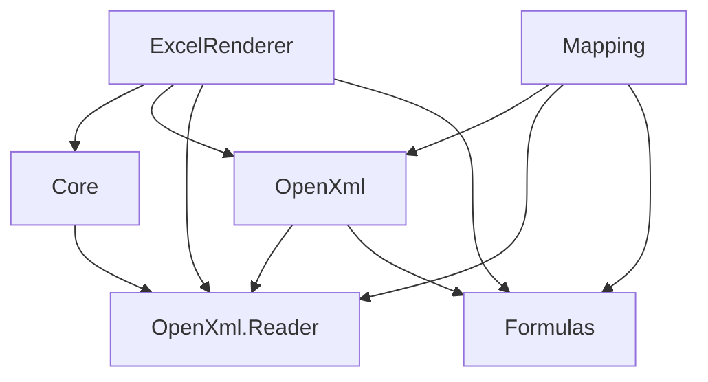

# OpenXml.Reader split: migration and verification

This source change starts from fetched main `283dc5b64d4ad54f640d3c6d179f0fff2b0631b1` on branch `refactor/openxml-reader-split`. The initial checkout was clean at `06280e538df4ebc49989efcb3f239379ffa1e09b`. No release version is selected or published by this change. Examples using the new Reader namespaces require packages built from this revision; historical published versions retain their recorded API.

## Dependency and source ownership



Reader and Formulas have no product-project references. Formulas remains BCL-only; Reader uses DocumentFormat.OpenXml 3.3.0 and ExcelNumberFormat 1.1.0. All product targets remain netstandard2.1. The only new product csproj is Reader; only main, Mapping, Tool and Fonts are packable.

Reader owns streaming read entry points at its root, immutable models, saved-value formatting, raw/shared formula metadata, diagnostic codes, bounded input/spools, print-reference parsing and shared XML/stream helpers. The Writer-only relationship checker stays in OpenXml, together with structural references, writing/staging, shared-formula expansion and recalculation.

Core's sole product reference is Reader. CoreExcelReader creates one optional generic value resolver after opening a reader and before starting its cell cursor. It keeps that resolver local to Read and applies it before resolving styles, typed style-cache lookup or formatting. Core returns null. FullExcelReader returns null for CachedValue, or captures one WorkbookCalculationSession and per-selected-sheet target policies for Recalculate. The policy retains exact page targets, selected ranges, print areas/titles, merged leaders, hidden/default-hidden axes and explicit visible rows; it reuses Reader metadata and Core's BandIndex. The existing adapter snapshot still reads nonselected worksheets for dependencies. Session/snapshot/cache lifetime is one read; these are managed objects without a disposal contract. Existing using scopes release Reader, streams and input storage on success, error or cancellation.

## Breaking API changes / API移行

Update imports and fully qualified/stored type names, then rebuild every application, library and plugin. These types move from ExcelRenderer.OpenXml.dll to ExcelRenderer.OpenXml.Reader.dll and change namespaces. There are no duplicate old-namespace facades or type forwarders; mixing old/new product DLLs is unsupported.

| Old namespace | New namespace | Public types |
| --- | --- | --- |
| `ExcelRenderer.OpenXml.Diagnostics` | `ExcelRenderer.OpenXml.Reader.Diagnostics` | `ReaderDiagnostic`, `ReaderDiagnosticCodes` |
| `ExcelRenderer.OpenXml.Formatting` | `ExcelRenderer.OpenXml.Reader.Formatting` | `CellDisplayResult` |
| `ExcelRenderer.OpenXml.Reading` | `ExcelRenderer.OpenXml.Reader` | `IWorkbookDataReader`, `OpenXmlReaderOptions`, `OpenXmlWorkbookReader` |
| `ExcelRenderer.OpenXml.Input` | `ExcelRenderer.OpenXml.Reader.Input` | `WorkbookInputOptions` |
| `ExcelRenderer.OpenXml.Model.Cells` | `ExcelRenderer.OpenXml.Reader.Model.Cells` | `CellAddress`, `CellRange`, `CellRecord`, `CellValue`, `CellValueType`, `FormulaInfo`, `RichTextRunInfo` |
| `ExcelRenderer.OpenXml.Model.Drawing` | `ExcelRenderer.OpenXml.Reader.Model.Drawing` | `ImageInfo` |
| `ExcelRenderer.OpenXml.Model.Printing` | `ExcelRenderer.OpenXml.Reader.Model.Printing` | `PrintRangeInfo`, `PrintReferenceInfo` |
| `ExcelRenderer.OpenXml.Model.Styles` | `ExcelRenderer.OpenXml.Reader.Model.Styles` | `CellStyleInfo`, `FontInfo` |
| `ExcelRenderer.OpenXml.Model.Workbook` | `ExcelRenderer.OpenXml.Reader.Model.Workbook` | `ColumnInfo`, `DefinedNameInfo`, `ElementInfo`, `RowInfo`, `SheetInfo`, `WorkbookInfo`, `WorksheetInfo` |

Public signatures that use these types also change, including:

- `ExcelRenderer.Excel.ExcelStyleConverter.Convert(CellStyleInfo, CellValueType)`.
- `ExcelRenderer.Mapping.Configuration.MappingOptions.Input` (`WorkbookInputOptions`).
- `OpenXmlWorkbookWriter.Write(..., WorkbookInputOptions?, ...)`.
- `WorkbookCalculationSession.Create(IWorkbookDataReader, ...)` and `EvaluateCell(CellRecord)` / returned CellRecord.
- `FormulaTextResolver.TryResolve(CellRecord, out string?)` and the moved Reader's own model/formatting signatures.

Core removes `ExcelRenderer.Core.FormulaDisplayMode`, `ExcelReadOptions.FormulaDisplayMode` and `ExcelReadOptions.FormulaEvaluationOptions`. Remove those settings when using Core's saved-value PDF conversion. Core retains ReadOptions and neutral selection plumbing. To recalculate, use main's unchanged ExcelRenderer.Excel.FormulaDisplayMode/ExcelReadOptions, or WorkbookRecalculator before Core. Main/Mapping high-level conversion/mapping entry points and CLI arguments keep their behavior.

Coreは数式の保存値だけを描画します。Coreの数式モード・評価オプションを使っていた呼び出しを修正してください。低レベルReader・モデル・書式・入力型は上表の名前空間へ移動するため、using・保存された型名の変更と依存側全体の再ビルドが必要です。本体・Mapping・CLIの再計算は維持しています。バージョン決定や公開はこの変更に含みません。

## Reproduction

```bash
source scripts/test-fonts.sh
dotnet restore ExcelRenderer.slnx --locked-mode
dotnet build ExcelRenderer.slnx -t:Rebuild --no-restore --verbosity:minimal -m:1
dotnet test ExcelRenderer.slnx --no-restore -m:1
python3 scripts/check-source-namespaces.py
python3 scripts/check-core-dependencies.py
python3 scripts/check-formulas-dependencies.py
dotnet build ExcelRenderer.slnx -c Release -t:Rebuild --no-restore --verbosity:minimal -m:1
python3 scripts/check-no-pdfsharp.py
python3 scripts/validate-reader-isolation.py
python3 scripts/package_distribution.py
dotnet pack ExcelRenderer.slnx -c Release --no-build --no-restore -p:BuildProjectReferences=false -o artifacts/packages-reader-split
python3 scripts/package_distribution.py --packages artifacts/packages-reader-split --output artifacts/package-inventory-reader-split.json
python3 scripts/validate-formulas-packages.py --packages artifacts/packages-reader-split --work artifacts/reader-split-package-consumers
```

Use empty directories for packages and consumers. The isolation check creates temporary Core-only and Reader-only ProjectReference consumers, restores/builds/publishes without pruning DLLs, audits project.assets.json/deps.json and actual PE AssemblyRefs, then executes published consumers as separate processes. Reader verifies numeric, string, Boolean, error, missing and shared cached results; Core generates PDF with the missing-cache diagnostic. Fixed fonts retain their existing licenses. The package check requires exactly four nupkgs and identical Reader/OpenXml/Formulas DLL hashes across main/Mapping/Tool and XML hashes across main/Mapping. Package-only consumers exercise main, Mapping, both, namespace samples and installed CLI. PR and reusable release CI also run the standalone isolation check.

For performance, save the unchanged pre-change performance runtime directory outside the checkout before rebuilding. Run after all builds, tests and consumers have finished:

```bash
python3 scripts/benchmark-reader-split.py --before /workspace/reader-split-before --after tools/ExcelRenderer.Performance/bin/Release/net10.0 --output /workspace/reader-split-performance
```

The benchmark builds the same source harness against each set of unchanged product DLLs, validates product hashes before/after, uses fixed Noto Sans JP with system/font-pack discovery off, en-US culture, 100,000 plain cells and 20,000 formula cells, and measures Core cached reading, main cached reading and main recalculation. Each of three alternating-order fresh-process rounds uses ten warm-up and five measured reads. It records elapsed time, cumulative allocation bytes, process-lifetime peak RSS, existing phase/read counters and display hashes. This measures input/reader/model projection, not PDF layout/render/save; RSS includes process warm-up and retained native caches. Platform results establish only the machine actually measured.

## Recorded validation

Executed on Debian 13 Linux x64, SDK 10.0.401 / runtime 10.0.12. Evidence and command logs are retained in [validation/openxml-reader-split](validation/openxml-reader-split/README.md).

| Check | Result |
| --- | --- |
| Fetched main / work branch | `283dc5b64d4ad54f640d3c6d179f0fff2b0631b1` / `refactor/openxml-reader-split` |
| Baseline Release rebuild and tests | 0 warnings / 0 errors; 2,169 passed |
| Final Debug and Release rebuilds | Each 0 warnings / 0 errors |
| Full Debug suite before the last three tests | 2,174 passed |
| Full Release suite | 2,177 passed: Core 170, Formulas 833, Mapping 172, OpenXml 206, main 691, CLI 105; 0 failed / skipped |
| Final formula rerun after last rebuild | 30 passed, including parallel conversions and hidden/merged/off-sheet targets |
| Locked restore, 640 namespaces, dependency/ownership audits | Passed; Reader is the only new product project |
| Core/Reader isolated publish and execution | Passed; no old OpenXml/Formulas DLLs, graph entries or AssemblyRefs |
| Independent extraction of isolated Core PDF | Saved 999, saved, TRUE, #DIV/0!, 1000 and 7 present; missing-cache diagnostic preserved |
| Latest four nupkgs | Passed; Reader/OpenXml/Formulas DLL/XML hashes agree; no unpublished dependencies |
| Ten package-only consumers and installed CLI | Passed with latest packages in `artifacts/packages-reader-split-final` |
| Optional font package validation and fixed font hashes | Passed; unchanged fonts, identical Tool Fonts DLL |
| Independent PDF comparison | 25 fixtures, 0 unmet gates; historical reference A retains 51 already-reviewed differences; frozen Skia reference B requires 0 exceptions |
| Frozen Core PDFs / image evidence | 3 Core fixtures / 5 image fixtures passed; no frozen hashes changed |
| Regression detection mutations | 19 output, both shared geometry products, 4 Core regressions, 4 dependency contamination paths and 4 independent PDF/font corruptions detected; sources restored |
| Managed font evidence | 5 sfnt fixtures and 6 PDF pairs passed; independent font-format extraction passed |
| Removed dependencies | No prohibited PDF dependency in 1,107 active source/config files, 23 graphs, 778 PE AssemblyRef inventories or 4 packages; ClosedXML audit also passed |
| Formula profile comparison | 500 cases across engine, OpenXml and writer roundtrip: 1,500 matches; 4 Mapping cases across read/roundtrip: 8 matches |
| Strict Excel desktop oracle | **Incomplete**: checked-in observations contain 0 cases, so strict comparison returns 1; no profile mismatches. New Excel capture requires Windows/Excel |
| Windows execution | Not run in this Linux environment; CI retains Windows checks |

The default sandbox initially prevented proxy connections and test-host sockets. Network-enabled execution completed restore/fetch/tests. No automatic approval review rejected an action. Package consumers built inside artifacts use their own empty Directory.Build.props/targets to avoid inheriting repository source/analyzer configuration; product projects still use the normal analyzers. The CLI's minimal style-free fixture emits the existing MaximumDigitWidthFallback runtime diagnostic; build warning counts above are zero. There was no version change, push, merge or NuGet publication.

### Reader performance

The formal comparison uses the same harness source with three fresh-process rounds, alternating stage order, ten warm-up reads and five measured reads per process (15 measured samples per stage/case), process concurrency 1, default tiered compilation, en-US and fixed Noto Sans JP. It verifies every displayed value against the generated numeric expectation, and checks unchanged product hashes. Median results:

| Read/model workload | Cells | Before ms | After ms | Time delta | Allocated MiB before → after | Peak RSS MiB before → after |
| --- | ---: | ---: | ---: | ---: | ---: | ---: |
| Core saved values | 100,000 | 362.6 | 342.5 | -5.5% | 182.843 → 182.841 | 232.63 → 231.43 |
| Main saved values | 100,000 | 555.6 | 590.0 | +6.2% | 275.830 → 275.830 | 170.94 → 169.06 |
| Main recalculation | 20,000 | 314.8 | 323.3 | +2.7% | 160.923 → 160.923 | 139.06 → 138.27 |

Each measured read reports `openXmlReaderWorkbook=1` before and after. Median allocation deltas are under 2 KiB per read. Core/default main reads create no calculation snapshot; main recalculation creates one session in the read-local factory and reuses Reader metadata and the existing unrestricted dependency snapshot. Page-selection pre-reading still explicitly uses CachedValue. Rendering/layout/save are excluded from these measurements; process-lifetime RSS includes warm-ups and native high-water marks. The main saved-value median increased 6.2% and recalculation increased 2.7% in this run; these figures are measurements, not a universal performance guarantee.

The initial one-warm-up run is retained separately: its main recalculation median was 450.3 → 530.8ms (+17.9%), with large within-process JIT transitions and changing allocation counts. The corrected protocol increases warm-up count while retaining default runtime settings. Both raw datasets are available; the longer warm-up does not establish cold-start equivalence. No build, package consumer or independent comparison overlapped the formal measurement.

## Conditional formatting metadata and calculation extension

Reader now exposes saved ConditionalFormattingRuleInfo and DifferentialStyleInfo on WorksheetInfo without changing IWorkbookDataReader. It performs no evaluation. Main connects those snapshots through OpenXml WorkbookCalculationSession.CreateSavedValueSession / EvaluateFormula / ReadValue, sharing the existing recalculation snapshot when requested. Core retains only Reader and ordinary saved styles; its generic appearance completion hook is a no-op. See [Phase 1 support](conditional-formatting.md).

Phase 2 resolves colorScale descendant colors with the same Reader color path and bounds
cfvo val lengths. OpenXml EnumerateValueCells exposes sparse stored value/formula
coordinates on the existing shared snapshot; the main product owns union/statistics,
frequency keys, numeric thresholds and RGB interpolation. Core remains free of those
algorithms and has no new option or calculation snapshot.
