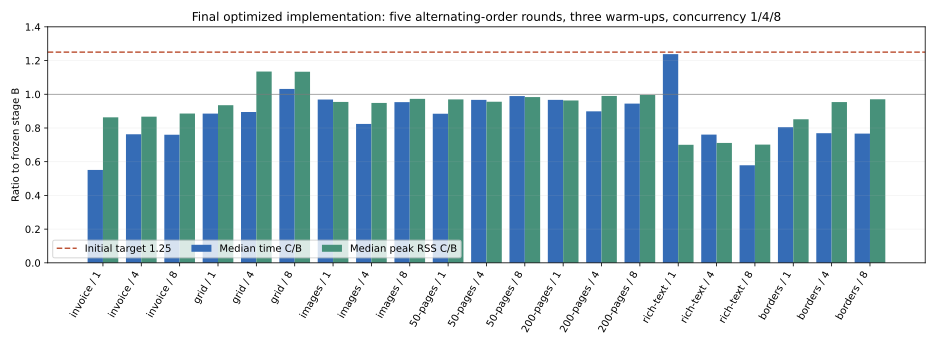
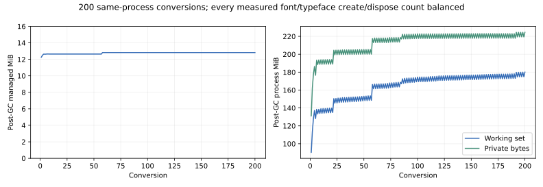

# PDFsharp removal validation

The later [PR #90 image review fixes](pr90-image-review-fixes.md) replace incremental
image revisions and add complete pixel validation. Measurements below remain
historical evidence for their recorded implementation.

The later performance/refactoring review and current CI status are recorded in
[the follow-up report](rendering-performance-review.md). The measurements below
remain evidence for their recorded implementation.

This report describes the work on `feature/remove-pdfsharp`, based on
`71deba48ea4a397641c9ad155bc1c8b3ddf8b5d9`. The first-stage draft PR #89 is
unmerged; fetched main remains `8d23c0725f60126f5e38c9a9e9a612a6d276b93a`.
The final product implementation is commit `0996eb0` (following `3510acc`).
No main update was missing from that base. This stage is an unreleased breaking
change. See [migration](pdfsharp-migration.md) and [inventory](pdfsharp-removal-inventory.md).

## Environment and reproducibility

Local validation uses Linux x64, .NET SDK 10.0.401/runtime 10.0.12, Release,
SkiaSharp 4.151.0 and the source-built HarfBuzz 10.2.0 subset adapter. Builds use
`-m:1 -p:UseSharedCompilation=false` to bound compiler/process memory and avoid
shared compiler lifetime affecting resource measurements. Fixed Fontconfig comes
from `scripts/test-fonts.sh`. Font paths, hashes and license hashes are recorded
in `tests/Shared/PdfRemovalBaseline/manifest.json`. Noto Sans JP's original download
URL was not recorded by the repository; this limitation is explicit in the manifest.

The old main/Core binaries used for manual performance comparison have SHA-256
`9f0af251ceb521085809bdb465e17e1477a881e8b664df3b6db3dedae1322204` and
`004687892f48b84aa4b2b2b39ba5a9eaf650c8e92594cab105aaf8ec3bd7099b`.
They match the reviewed first-stage performance record. Its final documentation
commit did not alter these product DLLs. Historical binaries live outside the
solution; no current build/test/CI restores or calls them.

```bash
python3 scripts/build-harfbuzz-subset.py
source scripts/test-fonts.sh
dotnet restore ExcelRenderer.slnx --locked-mode
dotnet build ExcelRenderer.slnx -c Release -t:Rebuild --no-restore -m:1 -p:UseSharedCompilation=false --verbosity:minimal
dotnet test ExcelRenderer.slnx -c Release --no-build --no-restore -m:1
python3 scripts/check-source-namespaces.py
python3 scripts/check-core-dependencies.py
python3 scripts/check-formulas-dependencies.py
python3 scripts/compare-pdf-backends.py --no-build --output artifacts/pdfsharp-removal-current
python3 scripts/compare-pdf-backends.py --no-generate --reference B --no-exceptions --output artifacts/pdfsharp-removal-current
python3 scripts/check-pdf-comparison-mutations.py --baseline artifacts/pdfsharp-removal-current
python3 scripts/compare-core-removal-baselines.py
python3 scripts/check-core-mutations.py
python3 scripts/check-output-mutations.py
python3 scripts/check-core-shared-mutations.py
dotnet pack ExcelRenderer.slnx -c Release --no-build --no-restore -m:1 -p:BuildProjectReferences=false -o artifacts/pdf-removal-optimized-packages
dotnet publish src/ExcelRenderer.Tool -c Release --no-build --no-restore -o artifacts/pdf-removal-optimized-publish
python3 scripts/package_distribution.py --packages artifacts/pdf-removal-optimized-packages --output artifacts/pdf-removal-optimized-inventory.json
python3 scripts/check-no-pdfsharp.py --packages artifacts/pdf-removal-optimized-packages --publish artifacts/pdf-removal-optimized-publish
python3 scripts/check-no-pdfsharp-mutations.py
python3 scripts/validate-formulas-packages.py --packages artifacts/pdf-removal-optimized-packages --work /workspace/pdf-removal-consumers-final
```

Do not run mutation scripts concurrently with builds, comparisons, audits or each
other: they temporarily change source files and restore them in `finally`.
An initial overlapping audit/rebuild was discarded after the audit correctly
failed on a disappearing build file; only the subsequent stable audit is evidence.

## Automated regression evidence

The clean run removed bin/obj for all 22 projects (44 directories), then restored
the locked graphs and rebuilt with zero warnings/errors. All 2,052 tests passed,
with zero skips: Core 102, Formulas 833, Mapping 172, OpenXml 206, main 640,
Tool 99. Existing PNG/SVG/Markdown golden checks passed all 31 cases without
updating their images/text. The source namespace check covers 625 declarations
and the two required compiler shims. Dependency direction and source ownership
checks pass for Core, OpenXml, Formulas and Mapping.

The frozen A/B comparison contains 25 fixtures, original commands and independent
expected text/geometry. A is old measurement/old drawing; B is old measurement/
Skia drawing; C is the new measurement/Skia drawing. The capture commit,
timestamp and every captured file hash are in the manifest. The 36 metric samples
match in width, ascent/descent, line count and baseline. Boundary cases at six
sizes test accumulated width ±0.001/0.01pt, including 1,000-character runs;
wrap comparisons use an exact inclusive bound, without compatibility epsilon.

Current command fingerprints, page plans, geometry and diagnostics are compared
directly against frozen JSON during generation. Independent MuPDF and Poppler
checks retain the first-stage extraction, dimensions, links, 144/300dpi regional
screening thresholds and reviewed exceptions. Content/font/image byte checks
also require the finalizer's original native PDF prefix and encoded streams to
survive. No new golden or broad exception is accepted for stage B→C.

The independent C# reader is test-only PdfPig 0.1.14 (Apache-2.0; its selected
net8.0 dependency group adds no packages). Its `Page.Text` ignores `/ActualText`
in some shared-glyph mappings. Unit probes therefore inspect extracted text and
the separate marked-content Unicode; independent MuPDF/Poppler enforce actual
source Unicode without stripping IVS or applying NFKC. Product packages include
neither PdfPig nor these external validation tools.

Fourteen additional frozen reader projections cover complete row/column bands,
MDW resolution diagnostics, merges, print settings and source rich runs. They were
captured with the same helper compiled against unchanged stage-B product binaries;
current generation compares them exactly. Style interning and lossless dimension
bands avoid duplicating styles or all 16,384 equal column definitions in the record.

Core also retains its original single static regular TTF validation, 96dpi MDW,
IVS reduction, diagnostics, page layout and borrowed output-stream contract.
The three frozen Core fixtures (four pages) retain page boxes, glyph IDs, exact source outlines and
glyph origins within 0.000092pt (invoice) / 0.017701pt (grid). Both independent
extractors restore six source emoji scalars previously lost at missing glyphs;
the input XLSX/font cmap independently defines their exact counts. No new fallback
or visible glyph support is added. Regional 144/300dpi screening finds 11
antialiasing-only differences; reviewed old/new/difference crops are recorded in
`reviewed-core-differences.json`. Each exception is restricted by the exact frozen
PDF hash, region bounds and current raster pixel hash, and cannot excuse distant
ink, changed glyphs/outlines or position errors. These are Core's old drawing→Skia
changes, separate from the zero-exception main B→C measurement comparison.

Generated-format parser tests exercise CR/LF variants, escapes, generation numbers,
inherited boxes, name trees, metadata, exact encoded stream retention and malformed
or unsupported input. Encrypted/signed PDFs and xref/object streams are rejected.

The public metadata diff removes only the three documented low-level classes:
resolver, renderer and measurer (18 signatures), adding the new renderer/measurer
(12 signatures). Core's public surface remains 90 signatures, with no additions
or removals. High-level conversion and custom service signatures are unchanged.

All 17 original Core raster pages also pass their existing 96dpi comparison,
without replacing the golden PNGs. One print-scaling page exceeds the 0.25 mean
channel screening target (0.278344). Its reviewed exception requires the exact
historical PNG/input hashes and exact current pixels. The frozen stage-B Core
PDF reproduces the historical PNG byte-for-byte in pixels; its 371 path types,
stroke widths and 345 glyph IDs match C, with bounds within 0.000016pt and origins
within 0.000062pt. Changed ink lies at horizontal table edges. Core and current
full-reference rasters are identical on that page. Other changed output cannot
use the exception. See `Baselines/skia-reviewed-differences.json`; the 0.25
screening threshold itself and historical golden remain unchanged.

## Dependency and distribution evidence

The layered audit scans source/configuration with exact-line exceptions, all
restored project assets, transitive NuGet package-list JSON, output filenames,
runtime graphs, PE AssemblyRefs, package manifests/DLLs and Tool publish output.
Historical JSON exemptions are individual file hashes, never folder exclusions.
The loaded-assembly test performs real Core/main/Mapping conversions. Deliberate
mutations prove detection of PrivateAssets references, restored dependency
contamination, an AssemblyRef hidden behind an unrelated DLL filename and a
packed dependency. No runtime dependency was replaced with a PDFsharp fork,
reflection load, subprocess or external service.

Exactly four packages remain publishable. Core/OpenXml/Formulas stay nonpackable;
main and Tool ship Core, main/Mapping share identical OpenXml/Formulas DLL/XML,
and Fonts remains optional. The isolated consumer driver records 18 graphs across all nine consumers'
restore/runtime libraries, including installed CLI. Removing the subset adapter
must abort both default/explicit PDF output while Markdown still succeeds.

## Measurement, lifecycle and PDF limits

Formal B/C measurements use seven workloads, five fresh-process rounds each,
three warm-up conversions per process and concurrency 1/4/8. The same timed
measurement wrapper delegates all three layout interfaces in both harnesses;
old product DLL hashes are verified. `TotalMs` excludes harness startup but includes
conversion setup; lifetime peak RSS includes warm-ups. Managed allocation is
cumulative during the measured conversion. No builds/consumers/comparisons run
alongside formal performance samples. A lightweight local commit was created
during the initial matrix. An initial five-condition measurement was
interrupted after an independent-renderer scope issue was found in review; those
rows remain preliminary and are excluded from final results.

```bash
python3 scripts/benchmark-pdf-backends.py --no-build --baseline-assembly /tmp/excelrenderer-stage1-benchmark-bin/ExcelRenderer.Performance.dll --inputs artifacts/pdf-removal-benchmark --output artifacts/pdf-removal-benchmark-final
dotnet tools/ExcelRenderer.Performance/bin/Release/net10.0/ExcelRenderer.Performance.dll render-case samples/mapping/invoice/invoice.xlsx pdf paginated 100 --font-pack --measure-text --pdf-backend skiasharp
```

The initial A/B/C matrix retains all 1,365 measured process records (5,460
conversions including warm-up). Nineteen conditions met the initial B-relative
time/RSS target. The grouped-stage run exceeded time at 200 pages/concurrency 1
(1.335) and rich text/concurrency 1 (1.599); no memory condition exceeded 1.25.
Those records are preserved in `benchmark-initial*`, including the failed targets.
After that run, the 8.8GiB tmpfs was found full from repeated isolated-consumer
package caches; only regenerable caches were removed. A measurement-only CPU/GC
harness, using unchanged product DLLs and alternating stage order, gave time
ratios 0.923 / 1.028 for those two fixtures, with matching GC collection counts.
This demonstrates material environment/order variability; it does not prove the
full initial delta came from one cause.

A normal-harness alternating rerun passed 200 pages at 0.979 time / 0.972 RSS,
but rich text still exceeded time at 1.297. Candidate-line allocation was removed,
then conversion-local prefix-width and finalized-line caches were added. They
retain exact width arithmetic and wrap boundaries, include style/registration
generation, apply only to the built-in manager and each bound entries/text at
512/2048. Finalized runs still retain immutable glyph/source data. The focused
rich fixture reached 1.108 time / 0.733 RSS, with measurement median 91.887ms
versus B 112.075ms. The complete optimized B/C matrix is recorded separately;
no initial sample was removed and no target was relaxed.

The final matrix alternates B/C forward and reverse order by round and reuses
identical XLSX bytes. All **21 median time/RSS conditions pass 1.25** across
910 process measurements (3,640 conversions including warm-up). The worst median
time is 1.238 (rich text / 1); the worst median RSS is 1.135 (grid / 4).

| Workload | Parallelism | Median time C/B | Median peak RSS C/B |
| --- | ---: | ---: | ---: |
| invoice | 1 | 0.551 | 0.863 |
| invoice | 4 | 0.763 | 0.867 |
| invoice | 8 | 0.760 | 0.886 |
| grid | 1 | 0.885 | 0.935 |
| grid | 4 | 0.895 | 1.135 |
| grid | 8 | 1.032 | 1.134 |
| images | 1 | 0.969 | 0.955 |
| images | 4 | 0.824 | 0.949 |
| images | 8 | 0.953 | 0.973 |
| 50-pages | 1 | 0.884 | 0.970 |
| 50-pages | 4 | 0.967 | 0.956 |
| 50-pages | 8 | 0.989 | 0.983 |
| 200-pages | 1 | 0.967 | 0.963 |
| 200-pages | 4 | 0.899 | 0.990 |
| 200-pages | 8 | 0.944 | 0.996 |
| rich-text | 1 | 1.238 | 0.700 |
| rich-text | 4 | 0.761 | 0.711 |
| rich-text | 8 | 0.579 | 0.701 |
| borders | 1 | 0.804 | 0.852 |
| borders | 4 | 0.769 | 0.954 |
| borders | 8 | 0.766 | 0.970 |

The maximum sample ratios are also reported, rather than discarded: invoice / 4
has a maximum-time ratio of 1.983 and rich text / 1 is 1.402; other maximum-time
ratios and all maximum-RSS ratios are within 1.25 (worst maximum RSS 1.060).
Thus these data satisfy the median target, not a guarantee of every individual
tail time. Total time, measurement/subset/page/save phase medians and maxima,
managed allocations, output sizes, original samples and conditions are retained
in [the evidence directory](pdfsharp-removal-results/README.md).



The final same-process 100-conversion test balances all created/disposed
resources: 100 typefaces, 400 PDF fonts and 100 subset typefaces. A further
200-conversion run balances 200 / 800 / 200, respectively. After-GC managed bytes
settle near 12.82MiB: in the 200-run last half, min/max are 13,443,840 /
13,452,064 bytes. Native memory retains a high-water mark; private-memory window
medians are 220.25MiB (iterations 100–119), 220.44MiB (150–169) and 221.21MiB
(180–199), with working set 172.57 / 174.57 / 176.36MiB. These bounded-run data
do not prove an infinite-duration flat RSS. They show balanced ownership and no
per-conversion retained font-byte growth. Raw per-iteration observations are
included, with no forced native allocator release claimed.



The CLI 50-/200-page files contain one font object each (135,533 / 529,932 bytes).
The current one-page invoice is 33,386 bytes; small fixture sizes and embedded
font/image stream details are included in the comparison evidence. Multi-page
font reuse is measured separately from the image-heavy incremental-stream cost.

Resource tests cover nested/exceptional AsyncLocal restoration, caller ownership,
snapshot replay after the source font is deleted, simultaneous Core/main jobs at
1/4/8 with the same family pointing to different bytes, and standalone shared
measurement services. Additional tests run eight independent renderers under an inherited outer session, verify an injected Skia service borrows one conversion scope, mutate caller-visible font bytes after
layout and switch a custom manager's physical face without changing its family;
replay keeps the private immutable snapshot and fresh calls see the new face.
Built-in standalone rich reuse is bounded by eight weak references; it does not
own returned layouts/font bytes. Conversion-local strong caches remain bounded
by 512 entries/2048 characters. Skia's global unused-strike purge occurs after owned resources
are disposed, without a global conversion lock. Separate-process performance
samples do not establish in-process throughput.

The finalizer appends 0.001pt page boxes, the original device-RGB transparency
group, links/tooltips and `/Interpolate true` for non-mask images. Existing drawing,
font and image data are not recompressed. Incremental image dictionary revisions
repeat encoded image streams, so image-heavy output can grow; this is measured
separately from subset effectiveness. Internal spool memory is limited to 8MiB
before spilling, with cancellation/failure cleanup. Scalable text uses sfnt
advances in double precision; native color strike advances retain the previous
policy. PNG/SVG emit stored glyph IDs with their established native raster
advance/hinting policy, preserving their golden output.

## Platform and viewer status

Linux x64 source-built native conversion, package/publish/installed CLI and isolated
consumers are exercised locally. Windows x64 workflows build the pinned adapter,
exercise Core/main/CLI and audit packages; **this stage's Windows run has not been
executed**. The previous PR's successful Windows run does not validate these new
changes. ARM64/macOS binaries and additional RIDs have not been validated here.
No untested RID is claimed as verified.

Edge and Adobe Reader manual checks are **not performed** in this environment.
On both viewers open the invoice, commands-1, links-selected, images and 200-page
fixtures; search/copy Japanese, supplementary characters and IVS; follow URI and
internal links; inspect tooltips; print at actual size and verify page edges,
hairlines, clipped/rotated images and header/footer positions. Expected Unicode,
dimensions and link targets are in each fixture's frozen `expected.json`.
Automated checks do not substitute for those viewer checks.

At the time of the recorded local run, the mandatory Windows/native gate was
outstanding. Automatic approval review initially rejected push under plan §0.
The user subsequently explicitly authorized a draft PR and branch updates;
[draft PR #90](https://github.com/akrym1582/ExcelRenderer/pull/90) is now open on
`feature/remove-pdfsharp`, stacked on #89. The follow-up report records the actual
Windows runs, the source-backed native-metric rounding diagnosis and the final
verification status. The prior blocked status in the frozen JSON remains historical
evidence, not the present publication status. Merge and package publication remain
separate release work.
