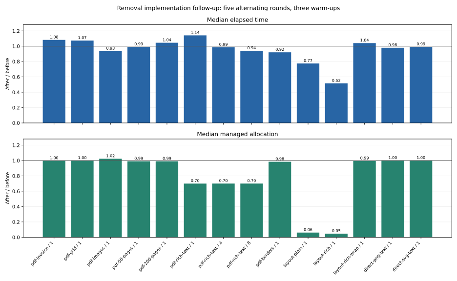

# 撤去後の性能・構造の再点検

比較元はPDFsharp撤去済みの `1e1f509`（製品実装 `0996eb0`）です。
第1段階Bとの比較は既存の[撤去検証](pdfsharp-removal-validation.md)に保持し、
今回は現在の実装に対する追加改善を確認します。

## 変更

- `SkiaFontFace`がglyph配列をまとめて計測します。scalable fontではsfnt整数advanceから
  従来と同じ演算順で個別advance/originを作り、色フォントでは一度のnative計測にまとめます。
  glyphごとの一時配列・enumerator・native font生成を省きます。
- Coreの行作成はglyph選択を一度だけ実行し、計測とfinalizationで再利用します。
  `PdfFontCollection`は物理snapshotで確認済みのcolor属性を使用します。
- FontManagerの連続run結合を `TextRunBuilder` に分離しました。成長する文字列の全prefixを
  毎回コピーする処理をStringBuilderへ置き換えます。物理face・explicit glyph・missing flags・
  UTF-16連続性という既存の結合条件を維持し、IVS置換時もsource/displayを別々に保持します。
- rich textの連続styleの結合を共通化し、計測候補とfinalized lineの両方が同じ分割を使います。
  確定行で文字を追加するたびに文字列とrecordを作り直す処理を除去しました。

公開APIの追加破壊は必要ありませんでした。新しいglobal cacheや変換lockは追加していません。
読み取り・ページ計画・subset・finalizerも点検しましたが、今回の根拠から効果を判断できる
箇所に変更を絞っています。折り返し候補は引き続きwhole-stringで正確に計測します。
単純な文字幅の加算へ変えるとfallback・IVS・丸め境界が変わり得るため採用していません。

## 測定条件

Linux x64、Release、.NET SDK 10.0.401/runtime 10.0.12。同じharnessを変更前後の製品DLLで
実行します。別プロセス5round、各3warm-up、前後順序をroundごとに反転し、全sampleを保持します。
測定はビルド・テスト・package consumerと重ねません。RSSはwarm-upを含むprocess lifetime
peak、managed割当は測定区間の累計です。測定commandと詳しい範囲は
[ハーネスREADME](../tools/ExcelRenderer.Performance/README.md)にあります。

7種類のPDFのconcurrency 1、rich textの4/8、3種類のlayout単独測定、直接PNG/SVG文字描画を
比較します。layout単独では一意な長文・mixed size・折り返しを使い、whole-layout cacheへの
依存を避けます。layoutのtext/style/寸法/originと画像成果物のhash一致を検証します。
PDFの正しさは既存の独立reader・frozen B→C・Core比較でも確認します。

## Windowsのメトリクス差

最初のWindows native CIでは74件中73件が成功し、Linuxで捕捉したfloat baselineとの差
約0.000001ptだけが凍結metrics比較で失敗しました。Skia m151の
[DirectWrite実装](https://github.com/google/skia/blob/chrome/m151/src/ports/SkScalerContext_win_dw.cpp)は
`size * ascent / unitsPerEm`、
[FreeType実装](https://github.com/google/skia/blob/chrome/m151/src/ports/SkFontHost_FreeType.cpp)は
`(ascent / unitsPerEm) * size`をfloatで計算します。例えばNotoのascent 1160、units 1000、
size 10では11.600000381469727と11.59999942779541になります。

テストは同じfontのhead/hheaからそれぞれの期待値を独立に計算します。
Linuxの凍結値自体とも一致を確認し、既存の0.0000001ptの比較閾値を維持します。
製品の行metrics、glyphや折り返し、凍結baselineを変更していません。
各platformの実測値を `SampleOutputs/PdfMetrics/platform-metrics.json` に出力します。

Windowsの再実行ではmainの対象117件とCLI99件が成功しました。その後の依存監査は
Gitのautocrlfによる履歴JSONのCRLF化で停止しました。`.gitattributes` でJSONをLFに固定し、
凍結capture全体をtext変換対象から外します。ハッシュは変更せず、`core.autocrlf=true` の
checkout実験で履歴JSONと凍結metricsのbyte一致を確認しました。

## 回帰と配布

最終Release Rebuildは警告・エラー0、全2,058テスト成功（skip0）です。
Core102、Formulas833、Mapping172、OpenXml206、main646、Tool99。
6種font形式で、batch advanceとoriginが個別glyphの従来演算に一致することを追加確認しました。
既存のIVS・combining・fallback・UTF-16 offset・rich style・snapshot lifetimeの検証も通っています。

独立A→C 25fixtureは未達0で第1段階の51レビュー差分のみ、例外追加なしのB→C 25fixtureは
未達0・差分0です。Coreの3凍結fixture（4page）も成功しました。既存PNG/SVG/Markdown goldenを
更新していません。今回の公開API metadata差分はmain/Coreとも追加0・削除0です。

4配布package、9隔離consumerとinstalled CLI、22復元graph、788 AssemblyRefの再検証も
成功しました。初回consumer実行のFontconfig警告後、固定Fontconfigを引き継いで全9件を再実行し、
最終記録は同じfont条件に揃えています。

## 最終測定

14条件、240 fresh-process測定を保存しました。PDFは190 process × 4変換（760変換）、
layoutは30 process × 4 batch × 30 calls、直接画像描画は20 process × 4 calls × 3pagesです。
各processの最後の測定を集計し、warm-upの時間を混ぜていません。

| ケース | 並列 | 時間中央値 前→後（ms） | 時間比 | managed割当比 | peak RSS比 |
| --- | ---: | ---: | ---: | ---: | ---: |
| pdf-invoice | 1 | 50.65 → 54.82 | 1.082 | 0.997 | 1.007 |
| pdf-grid | 1 | 433.76 → 465.37 | 1.073 | 0.999 | 1.001 |
| pdf-images | 1 | 739.77 → 691.69 | 0.935 | 1.023 | 1.020 |
| pdf-50-pages | 1 | 949.07 → 940.35 | 0.991 | 0.990 | 1.008 |
| pdf-200-pages | 1 | 1526.07 → 1594.46 | 1.045 | 0.990 | 1.045 |
| pdf-rich-text | 1 | 187.61 → 214.11 | 1.141 | 0.699 | 0.941 |
| pdf-rich-text | 4 | 314.84 → 310.23 | 0.985 | 0.700 | 0.905 |
| pdf-rich-text | 8 | 400.55 → 376.78 | 0.941 | 0.700 | 0.900 |
| pdf-borders | 1 | 900.39 → 828.79 | 0.920 | 0.984 | 1.006 |
| layout-plain | 1 | 182.01 → 141.00 | 0.775 | 0.061 | 0.782 |
| layout-rich | 1 | 311.69 → 160.70 | 0.516 | 0.047 | 0.943 |
| layout-rich-wrap | 1 | 49.50 → 51.49 | 1.040 | 0.995 | 1.004 |
| direct-png-text | 1 | 235.18 → 230.44 | 0.980 | 1.000 | 1.004 |
| direct-svg-text | 1 | 39.95 → 39.58 | 0.991 | 1.000 | 1.004 |

一意な長文のlayoutはplainで約23%、richで約48%短縮し、managed割当は約94% / 95%減りました。
入力・描画・保存・scope解放を含めない単独測定の値であり、PDF変換全体に同じ倍率は適用できません。
PDF rich textの割当は約30%減少し、並列8の時間は約6%短縮しました。一方、単独rich PDFは
約14%、invoiceは約8%、gridは約7%増えました。PNG/SVG直接描画は概ね同等です。
すべての前後値、最大値、phase・resource数・snapshotを保持し、遅いsampleを除外していません。
共有VMとJIT/GCの変動を含むため、小差を確実な高速化として扱いません。

時間が増えたrich PDF / concurrency 1は、従来の第1段階Bとも同じ入力で別途5fresh roundを
対にして確認しました。B 229.51ms → 現在222.27ms（0.968倍）、peak RSS 0.619倍で初期目標
1.25以内です。第1段階Bとの21条件測定全体は以前の記録のまま残し、今回その全matrixを
測り直したとは主張しません。別runの比を掛け合わせて性能を推定していません。

改善版の同一process 100回反復は、typeface 100、PDF font 400、subset typeface 100の
生成/解放がすべて一致しました。GC後managed中央値は最初20回12.51MiB → 最後20回12.67MiB。
private memoryは180.76MiB → 209.06MiB、working setは117.07MiB → 150.05MiBで、native cacheの
高水位は残ります。通常処理に強制GCを追加していません。以前の200回観測は旧実装の記録として
保持し、今回の100回の結果と区別しています。無期限の一定RSSは主張しません。

[完全なsampleと集計](rendering-performance-results/README.md)に、DLL/source/input hashes、
全240 sampleと追加B比較10 sample、100回反復、API/配布/独立font抽出結果を含めています。

## CIと手動確認

実装コミット `104d685`、checkoutの改行固定 `8145afe` に対する
[CI run 128](https://github.com/akrym1582/ExcelRenderer/actions/runs/39120859579)では、
Windows/LinuxのCore、Formulas、native jobが成功しました。native jobはmain117件・CLI99件、
4package/publish監査、9隔離consumerを含みます。Linuxの全solution 2,058件と独立比較は
ローカルでも成功しています。7jobすべて成功し、最終状態を証跡JSONに記録しました。

Edge/Adobe ReaderのGUI確認は未実施です。[撤去検証の手順](pdfsharp-removal-validation.md#platform-and-viewer-status)を
保持します。ドラフトPR #90と専用branchを更新し、merge・NuGet公開は行っていません。
