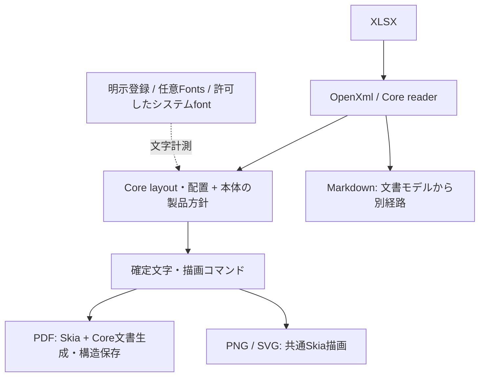

# SkiaSharp統一後の描画・フォント・配布設計

[English](skia-rendering.md) | 日本語

現在のExcelRendererで、SkiaSharpへの統一とあわせて行った対応をまとめます。
処理段階全体は[アーキテクチャ](architecture.ja.md)、実装の所属は
[Core構成](core-architecture.ja.md)と[所有者表](core-source-map.md)を参照してください。
この文書は現在の設計を説明し、個々の実装時点の測定結果は末尾の検証文書へ分けています。

## 1. 計測と描画を同じ基盤に揃える

PDFの生成と、既定のPDF／PNG／SVG向け文字計測をSkiaSharpへ統一しました。
PDFsharpの製品実装・通常依存・配布物は撤去済みです。`PdfBackend.SkiaSharp = 1`が
既定かつ唯一の実装で、旧値0は別のbackendとして動作せず、入出力を扱う前に拒否します。
低レベルAPIの置換と保存済み設定の移行は[移行表](pdfsharp-migration.md)にまとめています。

座標はポイントで保持し、PNG出力時にDPIを使ってピクセルへ変換します。
文字計測は実際の物理フォント、glyphとadvanceを使い、確定した文字を描画時に再び
折り返したり別のfontへ選び直したりしません。Excel列幅用の96dpiで丸めたMDWと、
文字配置用のスケーラブルなadvanceは分けて扱います。PNG／SVGには既存のラスタ向け
advance方針もあるため、形式間で全画素が同じになるという契約ではありません。

## 2. 共通Coreと本体の役割

| 所属 | 担当 |
| --- | --- |
| `ExcelRenderer.OpenXml` / `Formulas` | XLSX入力・検査・入力spool、元データと型付き編集、独立した数式計算 |
| `ExcelRenderer.Core` | 共通reader、geometry、ページ計画、配置、セル描画、font face・subset、画像取得、PDF文書と構造保存 |
| `ExcelRenderer` | 公開API、本体のfont fallback・IVS・部分書式、図形・変形画像、選択・trim・リンク、PDF／PNG／SVG／Markdownの統括 |
| `ExcelRenderer.Mapping` | 描画・fontへ依存しないテンプレート構文、データ評価とXLSX展開 |

本体はCoreを参照し、Coreから本体・Fonts・Toolへの逆参照は持ちません。
共通アルゴリズムはCoreに置き、本体の公開型と製品固有の方針はadapterで接続します。
本体のPDF入口は`PdfRenderer`で、`SkiaPdfDocumentWriter`と`SkiaPdfFonts`が
Coreの文書・font資源を利用します。

Core単独の製品は、指定した通常フォント一つを使うPDF専用の範囲を維持します。
本体のfallback、図形、リンク注釈、変形・分割画像、範囲選択がCoreの公開機能へ
増えたという意味ではありません。詳細は[Coreの対応範囲](core.ja.md)を参照してください。

## 3. フォントを任意パッケージへ分離する

| 公開パッケージ | 配布上の役割 |
| --- | --- |
| `ExcelRenderer` | 本体とCore／OpenXml／FormulasのDLL・XML。同梱font packageへの必須依存は持たない |
| `ExcelRenderer.Fonts` | 任意のNoto Sans JP Regular、IPAmj Mincho、Noto Color Emojiとライセンス |
| `ExcelRenderer.Mapping` | MappingとOpenXml／Formulas。描画や日本語fontを必要としない用途向け |
| `ExcelRenderer.Tool` | CLIと必要なassembly。Fontsも同梱し、追加導入なしで利用できる |

Core／OpenXml／Formulasを別NuGetパッケージとして要求しない構成です。
本体・Mapping・Toolへ同梱する共有DLLは同じbuildの内容を使います。
CLIのFontsはツール内のDLLと実行時依存情報で確認し、通常のNuGet依存を列挙する
nuspecだけでは判定しません。[配布契約](package-distribution.md)に詳細があります。

font packageの分離により、自前fontを使うアプリやMappingだけの利用で大きなfont資源を
必須にせず、CLIには既定の日本語・IVS・カラー絵文字向け資源を用意できます。
`UseFontPack`と`AllowSystemFonts`は別設定です。再現性が必要な場合は、明示登録した
fontを使い、不要な探索を無効にします。

任意fontの探索は`ExcelRenderer.dll`と同じディレクトリのDLL内resourceを先に調べ、
次にその配下のfontファイルを調べます。特定のDLL名に固定せず、読み込めないDLLは
飛ばします。探索順・API例・IVSと絵文字の制約は[READMEのフォント説明](../README.ja.md#フォント)
を参照してください。

## 4. 物理font snapshotとPDF subset

計測とPDF描画は、同じ不変の物理font snapshotとglyph選択を共有します。
確定レイアウトはfont bytes・glyph ID・clusterを保持し、破棄されたnative handleを
持ち回りません。呼出側のfont bytesと内部snapshotも区別します。

PDFでは選択済みページのglyphを先に収集し、物理face単位のsubsetを準備してから
描画します。同じ文書の複数ページ・サイズでsubsetを共有し、元Unicodeとclusterも
描画へ渡します。主な共有実装はCoreの`SkiaFontFace`、`GlyphSequence`、
`PdfFontCollection`、`HarfBuzzSubset`です。

固定版HarfBuzz adapterとSkiaSharpのnative assetsがPDF実行時に必要です。
Python／CMakeはソースbuild用、独立PDF readerは検証用であり、利用アプリの
実行時依存ではありません。subset資源が欠落した場合は失敗として扱います。
対応font形式やshapingの制約は[移行時のruntime説明](pdfsharp-migration.md#runtime-and-ownership)
を参照してください。

## 5. native資源・cache・spoolの寿命を分ける

font、subset、画像のnative資源は変換ごとのscopeが所有します。内部計測は現在の
scopeを借り、独立した公開measurer／rendererは自身のscopeを所有して終了時に
元へ戻します。プロセス全体のfont resolverや変換を直列化するglobal lockは使いません。
呼出側から渡されたserviceとstreamの所有権は呼出側に残ります。

text layout cacheには件数・文字数の上限を設け、glyph advanceの一括計測、連続runの
結合、style segmentの共通処理で反復作業を減らしています。画像cacheも既定64MiBの
見積もり上限を持ち、使用中leaseと退役後の解放を区別します。

PDFは上限付きseekable spoolへ生成し、既定8MiBを超える場合は設定に応じて
一時ファイルへ退避します。本体では`RenderRequest.Buffering`で指定します。
入力spoolの設定とは独立し、完了・write失敗・cancel時に中間資源を解放します。
Skia自体は文書closeまで資源を保持するため、cache上限はプロセス全体のメモリ上限を
保証しません。各公開APIのstream条件は利用ガイドに従ってください。

## 6. 画像の完全デコードとPDFの構造保存

共有`ImageDecoder`はheaderだけでなく`SKCodec.GetPixels`の成功を確認します。
途中までしか復元できない入力は`ImageDecodeFailed`へ接続し、PDFの通常モードでは
後続描画を継続、strict／コード別error設定では成功成果物を登録しません。
PNG／SVGも同じ判定を使い、それぞれの既存診断方針を保ちます。

検証済み画素をcacheで共有し、font収集passでは画像をデコードしません。
利用可能なJPEGの元圧縮データを保持し、透過とEXIF方向を扱います。
PDFのcropは元画像の配置とclipで補間境界を保ちます。

`GeneratedPdfFinalizer`は、固定版Skiaが生成したPDFへ用紙boxの0.001pt補正、
RGB page group、リンク／tooltip、画像補間を反映します。各active objectと
圧縮済みstreamを一度ずつ書き、xrefを再構成します。content、font、画像、SMaskを
後処理で再圧縮せず、古い画像revisionを残して容量が倍になる問題を防ぎます。
対象は対応する生成PDFに限定します。詳細と再現結果は[画像レビュー修正](pr90-image-review-fixes.md)にあります。

## 7. CIと保守時の確認

配布前にsolution全体をbuildし、4パッケージの整合性と実際の依存graph・AssemblyRef・
配布物を監査します。テスト対象だけのbuildではsampleや監査ツールが不足します。

通常のPR CIとフォント分離CIは同じ`validate-font-packages.py`を実行します。
font未導入・導入済みの別consumer、現行3ファミリー、CLI内のFonts DLL一致と
実行時依存、インストール済みCLIを確認します。各回新しいNuGet cacheを使い、
同一バージョンの古いパッケージで成功することを防ぎます。

描画変更は既存の凍結PDF、独立readerによるUnicode・font・リンク・用紙寸法、
固定DPIでの画素比較でも確認します。性能は同一入力・font・実行条件を記録し、
改善と悪化を個別に報告します。全ケースの一律高速化を前提にしません。

## 実装への入口

| 確認する処理 | 主なソース |
| --- | --- |
| 任意fontの探索 | [OptionalFontPack](../src/ExcelRenderer/Fonts/OptionalFontPack.cs) |
| 計測と部分書式 | [SkiaTextMeasurer](../src/ExcelRenderer/SkiaSharp/SkiaTextMeasurer.cs)、[RichText](../src/ExcelRenderer/SkiaSharp/SkiaTextMeasurer.RichText.cs) |
| 変換scopeの所有権 | [RenderResourceSession](../src/ExcelRenderer/Rendering/RenderResourceSession.cs) |
| PDF font収集・subset | [SkiaPdfDocumentWriter](../src/ExcelRenderer/SkiaSharp/SkiaPdfDocumentWriter.cs)、[PdfFontCollection](../src/ExcelRenderer.Core/Pdf/PdfFontCollection.cs) |
| 完全デコードとcache | [ImageDecoder](../src/ExcelRenderer.Core/Rendering/ImageDecoder.cs)、[ImageResources](../src/ExcelRenderer.Core/Rendering/ImageResources.cs) |
| PDF構造保存 | [GeneratedPdfFinalizer](../src/ExcelRenderer.Core/Pdf/GeneratedPdfFinalizer.cs) |
| フォント配布の共通検証 | [validate-font-packages.py](../scripts/validate-font-packages.py) |

## 関連資料

| 知りたいこと | 資料 |
| --- | --- |
| 公開APIと旧backend設定の移行 | [移行表](pdfsharp-migration.md) |
| 共通処理と製品差分の置き場所 | [Core構成](core-architecture.ja.md)、[所有者表](core-source-map.md) |
| NuGet内容・native assets・隔離consumer | [配布契約](package-distribution.md) |
| 撤去時の比較・API差分・配布監査 | [撤去検証](pdfsharp-removal-validation.md) |
| 文字計測・run結合の改善と測定条件 | [性能・構造レビュー](rendering-performance-review.md) |
| 画像診断・単一保存・容量と速度の実測 | [画像レビュー修正](pr90-image-review-fixes.md) |

検証文書の数値は、記載されたcommit・OS・fixtureについての実行結果です。
現在の設計を説明するこの文書と、過去の測定結果を読み分けてください。
