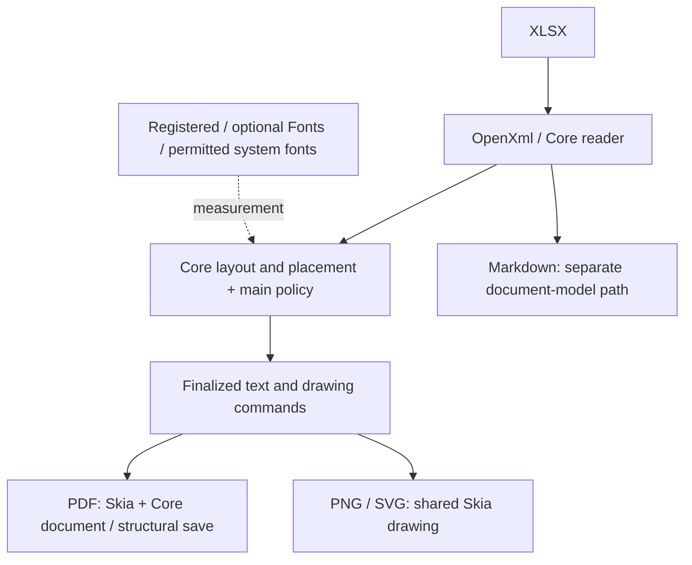

# Skia rendering, fonts and distribution design

English | [日本語](skia-rendering.ja.md)

This is an overview of the current Skia design and the changes accompanying its
adoption. Start with [architecture](architecture.md) for processing stages and
[Core architecture](core-architecture.md) / [source ownership](core-source-map.md)
for implementation boundaries. Measurements remain in their commit-specific reports.

## 1. One measurement and drawing foundation

PDF generation and default PDF/PNG/SVG text measurement use SkiaSharp. The
previous PDF implementation is removed from product code, normal dependencies
and distributions. `PdfBackend.SkiaSharp = 1` is the default and only available
implementation. Reserved zero is rejected before input/output access. See the
[API and stored-setting migration](pdfsharp-migration.md).

Geometry stays in points; PNG converts to pixels at output DPI. Measurement
selects physical fonts, glyphs and advances that finalized drawing reuses without
another wrap or font selection. Rounded 96-dpi maximum digit width for Excel
columns is separate from scalable text advances. PNG/SVG retain their native
raster advance policy; sharing primitives does not promise identical pixels
between output formats.

## 2. Shared Core and product policy

| Owner | Responsibility |
| --- | --- |
| OpenXml / Formulas | XLSX input, validation/input spooling, source records, typed edits and independent calculation |
| Core | Shared reading, geometry, page planning, placement, cell drawing, physical faces/subsets, image acquisition and PDF document/save |
| Main | Public APIs, fallback/IVS/rich text, shapes/transformed images, selection/trim/links and multi-format orchestration |
| Mapping | Template syntax, data evaluation and XLSX expansion without rendering/font dependencies |

Main references Core; Core never references main, Fonts or Tool. Shared algorithms
belong in Core; adapters connect public main models and product policy. Main's
`PdfRenderer` uses `SkiaPdfDocumentWriter` and `SkiaPdfFonts` to compose Core's
shared document and font primitives.

The standalone Core product remains single-regular-font/PDF-only. It does not
acquire main's fallback, shapes, annotations, transformed/split images or range
selection. See [Core scope](core.md).

## 3. Optional font package and four-package distribution

| Published package | Contents / purpose |
| --- | --- |
| ExcelRenderer | Main plus Core/OpenXml/Formulas DLL/XML; no mandatory dependency on the font package |
| ExcelRenderer.Fonts | Optional Noto Sans JP Regular, IPAmj Mincho and Noto Color Emoji, with licenses |
| ExcelRenderer.Mapping | Mapping plus OpenXml/Formulas for uses without rendering or Japanese fonts |
| ExcelRenderer.Tool | CLI and its required assemblies, including Fonts |

Core/OpenXml/Formulas do not require separate published packages. Shared bundled
assemblies come from the same build. Tool font dependencies are verified in its
bundled DLLs and runtime dependency graph, rather than ordinary nuspec dependency
groups. See the [distribution contract](package-distribution.md).

This separates large font resources from applications supplying their own fonts
or using Mapping, while keeping the CLI ready for Japanese text, IVS and color
emoji. `UseFontPack` and `AllowSystemFonts` are independent controls. For
repeatable results, register explicit fonts and disable unwanted discovery.

Optional fonts are discovered first in resources of neighboring DLLs, then in
loose files below the main assembly directory. Discovery does not require a
particular DLL name and skips unloadable assemblies. See [font usage](../README.md#fonts)
for search order, API examples and IVS/emoji limits.

## 4. Physical snapshots and PDF subsets

Measurement and PDF drawing share immutable physical font snapshots and finalized
glyph selections. Layouts retain font bytes, glyph IDs and clusters rather than
disposed native handles. Caller-owned font data is separate from internal snapshots.

PDF first collects glyphs from selected pages, prepares a subset per physical
face, then draws. Pages and sizes reuse document subsets, and original Unicode
and clusters accompany drawing. Core owns `SkiaFontFace`, `GlyphSequence`,
`PdfFontCollection` and `Fonts/TrueType/TrueTypeSubsetter`.

Core performs outline subsetting and TTC extraction in managed C#. Color fonts
retain their original normalized face and use Skia drawing. SkiaSharp native
assets remain required. See [supported formats and indices](managed-truetype-subset.md).

## 5. Resource, cache and spool lifetimes

Each conversion owns native fonts, subsets and images. Internal measurement
borrows its scope; independent public measurement/rendering owns and restores a
scope. There is no process-wide font resolver or conversion lock. Caller-supplied
services and streams remain caller-owned.

Text caches have entry/length limits. Batched advances, contiguous-run building
and shared style-segment processing reduce repeated work. Image estimates use a
default 64MiB cache budget with active leases and deferred release after retirement.

PDF generates into a bounded seekable spool. Main's default 8MiB threshold and
spill policy are controlled by `RenderRequest.Buffering`, independently of input
spooling. Intermediate resources are cleaned on completion, write failure and
cancellation. Skia still retains document resources until close, so cache budgets
do not bound total process memory. Public stream requirements remain API-specific.

## 6. Complete images and single-copy structural save

The shared decoder requires `SKCodec.GetPixels` success, not just a valid header.
Incomplete pixels produce `ImageDecodeFailed`. Normal PDF conversion continues
with later content; strict/code-specific errors register no successful artifact.
PNG/SVG use the same decode decision with their existing diagnostic policies.

Cached validated pixels are shared; font collection does not decode images.
Eligible JPEG data remains encoded, transparency and EXIF orientation are
preserved, and PDF crops map/clip the original image to retain interpolation edges.

`GeneratedPdfFinalizer` corrects 0.001pt boxes, RGB page groups, links/tooltips and
image interpolation in pinned Skia-generated PDFs. Each active object and encoded
stream is written once, with rebuilt xref offsets. Content/fonts/images/SMasks
are copied without recompression or obsolete image revisions that doubled file
size. This is limited to the supported generated format. See [image review fixes](pr90-image-review-fixes.md).

## 7. CI and maintenance

Distribution audits follow a full solution build and four-package verification.
Building only test targets leaves samples and audit tools missing.

Normal PR CI and standalone font-split CI invoke the same
`validate-font-packages.py`: separate consumers without/with Fonts, all three
current families, identical bundled tool fonts/runtime dependencies and an
installed CLI. Each invocation uses a fresh NuGet cache to avoid testing an old
package with the same version.

Drawing changes also use frozen PDFs, independent Unicode/font/link/page-box
checks and fixed-DPI raster comparisons. Performance reports identify inputs,
fonts and conditions, recording improvements and regressions separately rather
than promising a speedup for every workload.

## Implementation entry points

| Area | Main sources |
| --- | --- |
| Optional font discovery | [OptionalFontPack](../src/ExcelRenderer/Fonts/OptionalFontPack.cs) |
| Measurement and rich text | [SkiaTextMeasurer](../src/ExcelRenderer/SkiaSharp/SkiaTextMeasurer.cs), [RichText](../src/ExcelRenderer/SkiaSharp/SkiaTextMeasurer.RichText.cs) |
| Conversion resource ownership | [RenderResourceSession](../src/ExcelRenderer/Rendering/RenderResourceSession.cs) |
| PDF glyph collection/subsets | [SkiaPdfDocumentWriter](../src/ExcelRenderer/SkiaSharp/SkiaPdfDocumentWriter.cs), [PdfFontCollection](../src/ExcelRenderer.Core/Pdf/PdfFontCollection.cs) |
| Complete image decoding/cache | [ImageDecoder](../src/ExcelRenderer.Core/Rendering/ImageDecoder.cs), [ImageResources](../src/ExcelRenderer.Core/Rendering/ImageResources.cs) |
| PDF structural saving | [GeneratedPdfFinalizer](../src/ExcelRenderer.Core/Pdf/GeneratedPdfFinalizer.cs) |
| Shared font distribution check | [validate-font-packages.py](../scripts/validate-font-packages.py) |

## Further reading

| Topic | Document |
| --- | --- |
| Public APIs and old backend settings | [Migration](pdfsharp-migration.md) |
| Shared code and product boundaries | [Core architecture](core-architecture.md), [source ownership](core-source-map.md) |
| Package contents, native assets and isolated consumers | [Distribution](package-distribution.md) |
| Removal comparisons, API diff and dependency audit | [Removal validation](pdfsharp-removal-validation.md) |
| Text/run improvements and measurement conditions | [Performance review](rendering-performance-review.md) |
| Image diagnostics, storage, size and time measurements | [Image review fixes](pr90-image-review-fixes.md) |

Validation numbers describe their recorded commit, OS and fixtures. Historical
measurements should be read separately from this description of the current design.
