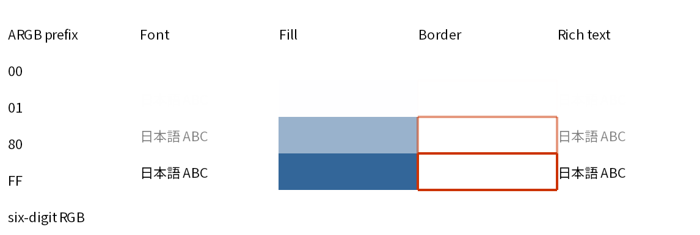
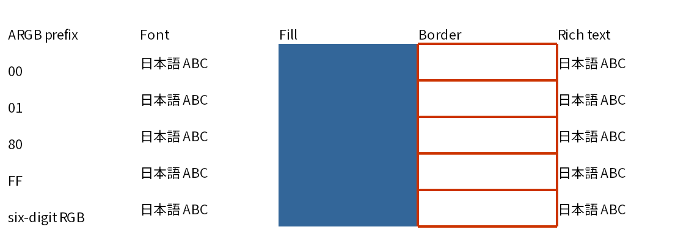

# SpreadsheetML cell ARGB validation

Validated on 2026-10-17/18, Debian 13 x64, .NET SDK 10.0.401/runtime 10.0.12.
Baseline: main `037cb12` (1.9.2). Related: [PR #52](https://github.com/akrym1582/ExcelRenderer/pull/52).

## Decision and scope

Render SpreadsheetML cell font, fill and border RGB as **opaque**, regardless of
the saved alpha byte. This includes inline/shared rich-text runs and custom
indexed colors. Absence of a fill still means no fill; theme/tint/automatic color
resolution is unchanged.

The [SpreadsheetML color definition](https://learn.microsoft.com/en-us/dotnet/api/documentformat.openxml.spreadsheet.color?view=openxml-3.0.1)
(ISO/IEC 29500-1, §18.8.9 / §18.18.86) describes `rgb` as ARGB. That describes the
stored representation; it is not evidence that Excel paints translucent cells.
[openpyxl's cell-style documentation](https://openpyxl.readthedocs.io/en/stable/styles.html#argb-colours)
explicitly says alpha is irrelevant for cell styles and that six-digit RGB is
prefixed with `00`. PR #52 records Excel ignoring the zero alpha while the
renderer made text invisible. We choose Excel-compatible cell rendering, rather
than interpreting the storage byte as drawing opacity. Nonzero intermediate
alpha is ignored too; special-casing just `00` would still fade cell styles.

The policy lives in **Core.Excel.OpenXmlStyleConverter.Color**, shared by Core
and the public main converter/reader, including rich text. OpenXml's StyleTable
continues to preserve `rgb`, `resolvedAlpha`, `baseRgb` and `resolvedRgb` as source
metadata. No workbook XML is rewritten by rendering. The public `ReportColor`,
model adapters, PDF/PNG renderers and DrawingML reader are unchanged.

DrawingML has a separate [alpha transform](https://learn.microsoft.com/en-us/dotnet/api/documentformat.openxml.drawing.alpha?view=openxml-3.0.1)
and images have per-pixel alpha; neither uses this SpreadsheetML conversion.
Tests guard drawing-model alpha 0/128/255 in PNG, intermediate PDF fill/stroke
opacity and image PDF soft masks. These tests do **not** claim full DrawingML
alpha-transform support: the current DrawingML reader does not apply `a:alpha`.
A separate pre-existing low-level PDF behavior was also observed: model alpha=0
black draws opaque in the unfinalized direct-command path, while alpha=128 draws
translucent. This patch does not change that path or expand DrawingML support.

**Excel application verification:** Excel desktop/online is unavailable in this
Linux environment. No new Excel screenshot or Excel-exported PDF was obtained.
The Excel compatibility conclusion uses the existing Excel observation in #52
and the documented cell-style behavior above. Direct Excel confirmation for this
fixture (especially `01` and `80`) remains a manual follow-up, not a claimed test.
Open `10-cell-argb.xlsx` in Excel and compare all five data rows: their four
appearance columns should match the `FF` row; record Excel version/platform and
an exported PDF when doing that follow-up.

## Fixture and observed output

[Minimal XLSX](../../../tests/ExcelRenderer.Tests/SampleInputs/10-cell-argb.xlsx):
one sheet, five columns, header plus five data rows. Prefixes `00`, `01`, `80`,
`FF` and six-digit input. Font/rich text use black, fill uses `336699`, all four
borders use `CC3300`. The six-digit row is passed through openpyxl and stored
with `00`, reproducing the original trigger without hand-editing the ZIP.

Regenerate with `pip install openpyxl==3.1.5`, then
`python3 scripts/create-cell-argb-fixture.py`. The script fixes ZIP timestamps;
the XLSX is retained so ordinary tests need no Python dependencies.
Fixture SHA256: `3d6e77900ea64b573eb26caf04c7ff7ddc34fab4b78c08a30fe0909faf9d9733`.

| Source alpha | Before: font/rich text | Before: PNG fill RGB | After: font/fill/border |
| --- | --- | --- | --- |
| `00` / six-digit input | invisible (PDF alpha 0) | 255,255,255 | opaque, original RGB |
| `01` | almost invisible (PDF alpha 1) | 254,254,255 | opaque, original RGB |
| `80` | faded (PDF alpha 128) | 153,178,204 | opaque, original RGB |
| `FF` | opaque (PDF alpha 255) | 51,102,153 | unchanged |

Before:



After:



Retained actual outputs:

- Main: [before PDF](before.pdf), [after PDF](after.pdf),
  [before PNG](before.png), [after PNG](after.png).
- Core: [before PDF](core-before.pdf), [after PDF](core-after.pdf).
- Published NuGet ExcelRenderer.Tool **1.9.2**: [PDF](package-1.9.2.pdf).
  Installed into an isolated directory with `dotnet tool install
  ExcelRenderer.Tool --version 1.9.2 --tool-path /workspace/argb-tools`.
  Tool version: `1.9.2+1067c5cd6fcd7927f3f81059354f2609dd4c288e`.
  Its PDF raster and PNG pixels match main-before exactly. Its PNG bytes are
  identical to `before.png` (SHA256
  `184015f4e931a413eb29d17d611c8cd21af7f06fa297c462b66cfdf238727820`).

[measurements.json](measurements.json) records file hashes, PDF text alpha and
144-DPI raster samples for fonts, fills and borders. Recompute it with
`python3 docs/validation/cell-argb/analyze.py` after installing the dependencies
listed in that script. PDF rasterization uses PyMuPDF/MuPDF independently of
ExcelRenderer's PNG renderer. Both corrected PDFs contain only text alpha 255;
font regions contain dark pixels and all fill/border samples retain their RGB.

From the repository root, output commands (run separately on the baseline and
patched source, using distinct fresh destinations):

```sh
dotnet src/ExcelRenderer.Tool/bin/Debug/net10.0/ExcelRenderer.Tool.dll pdf tests/ExcelRenderer.Tests/SampleInputs/10-cell-argb.xlsx -o /tmp/argb.pdf
dotnet src/ExcelRenderer.Tool/bin/Debug/net10.0/ExcelRenderer.Tool.dll image tests/ExcelRenderer.Tests/SampleInputs/10-cell-argb.xlsx -o /tmp/argb-png --dpi 144
```

Core's `Saved_Core_PDF_contains_visible_text_fill_and_border_paints` test writes
its PDF to the test binary's `SampleOutputs/10-cell-argb-core.pdf` directory.

## Regression checks

- New tests fail on baseline main for the zero/intermediate alpha, both readers,
  saved PDF opacity and PNG output. After the fix, main PDF content operators
  and PNG pixels match a control workbook changing only source alpha to `FF`.
  PNG checks independently require visible text, exact fill and border colors.
- Core tests check preserved source ARGB/alpha metadata, opaque model colors,
  saved PDF opacity resources, and actual text/fill/stroke operators.
- Tests cover all four border sides, six-digit RGB tolerance, custom indexed
  alpha, inline/shared rich text, default/no-fill styles, theme/tints/automatic
  colors, drawing-model transparency and transparent-image soft masks.
- The new fixture is excluded only from the historical pre-migration parent
  snapshot suite, whose manifest predates it. Its behavior is covered by the
  new explicit regression assertions; existing golden files are unchanged.
- [Existing output comparison](existing-output-comparison.json): Japanese grid
  report plus sample inputs 01–09, **10 workbooks / 18 pages**. All PNG pixels
  and all saved PDFs rasterized at 144 DPI match before/after exactly. Page
  counts match. Compare decoded pixels, not PDFs' time-dependent file hashes.

Final checks ([captured output](checks.txt)):

```text
dotnet build ExcelRenderer.slnx -t:Rebuild --no-restore --verbosity:minimal
  0 warnings, 0 errors
dotnet test ExcelRenderer.slnx
  Main 566, Core 85, OpenXml 206, Formulas 833, Mapping 172, Tool 83
  Total 1,945 passed, 0 failed, 0 skipped
python3 scripts/check-source-namespaces.py
  599 declarations match; 2 required compiler shims verified
git diff --check
  clean
```
